<h1 align="center"></h1>

<p align="center"><b>Your whole *arr stack on Postgres, with backups you can actually restore.</b><br>
Radarr, Sonarr, Lidarr, Prowlarr, Bazarr, Seerr and your download clients in one Docker Compose stack,<br>
plus the app that sets it up, wires it together, backs it up and keeps it updated.</p>

<p align="center">
  <a href="https://wranglarrr.github.io/Wranglarr/"><b>Docs site</b></a> ·
  <a href="https://github.com/Wranglarrr/Wranglarr/wiki/Quickstart"><b>Quickstart</b></a> ·
  <a href="https://github.com/Wranglarrr/Wranglarr/wiki"><b>Wiki</b></a> ·
  <a href="#features"><b>Features</b></a> ·
  <a href="https://github.com/Wranglarrr/Wranglarr/wiki/API"><b>API</b></a> ·
  <a href="https://github.com/Wranglarrr/Wranglarr/wiki/Troubleshooting"><b>Troubleshooting</b></a> ·
  <a href="https://github.com/Wranglarrr/Wranglarr/wiki/Release-Notes"><b>Release notes</b></a> ·
  <a href="ROADMAP.md"><b>Roadmap</b></a>
</p>

<p align="center">
  
  
  
  
  
  
</p>

<p align="center">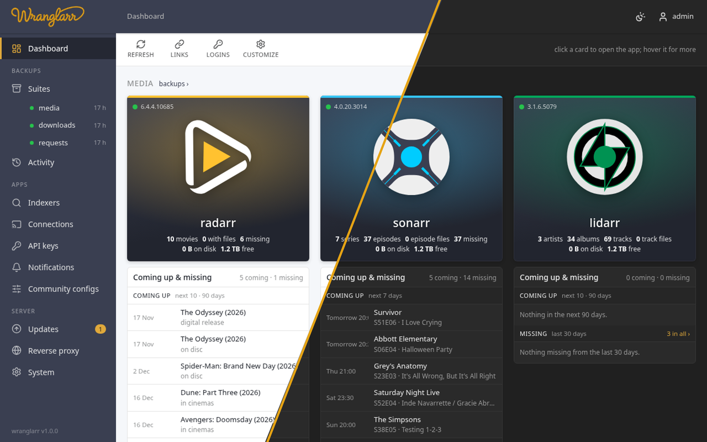</p>
<p align="center"><sub>The dashboard: every app with its stats, what's coming up, what's downloading and what's been requested. Light and dark follow your system, or flip them with one click.</sub></p>

## Why wranglarr

- **Backups that restore.** Every app's database and config, versioned on a schedule. Each version is a complete stack you can start with plain `docker compose up`, even without wranglarr.
- **Postgres done right, for you.** The arrs, Prowlarr, Bazarr and Seerr run on one Postgres 17, set up the way their wikis describe, with nothing to edit by hand.
- **Wired on first start.** Download clients go into every arr, the arrs into Prowlarr, Bazarr and Seerr. Each link is tested before it's saved.
- **One place to run it.** Updates, indexers, notifications, media servers, reverse-proxy config and app logins, behind a login with two-factor and passkeys.

## Features

<table>
<tr>
<td width="50%" valign="top">
<picture><source media="(prefers-color-scheme: dark)" srcset="wiki/images/readme/suite-media-dark.png">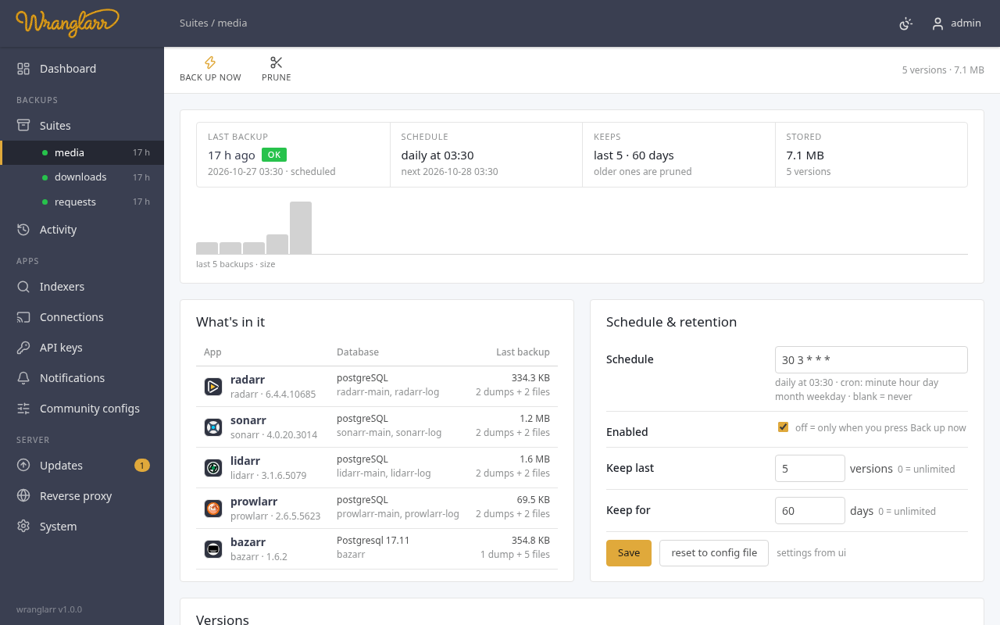</picture>
<h3>Scheduled, versioned backups</h3>
Databases (<code>pg_dump</code>), each app's own config backup and a plain copy of <code>/config</code>, grouped into suites. Cron schedule, keep-last / keep-days retention, size history, and what changed since the last version (an app upgraded, +12 movies).
<br><a href="https://github.com/Wranglarrr/Wranglarr/wiki/Backups-and-Restore">Backups and restore →</a>
</td>
<td width="50%" valign="top">
<picture><source media="(prefers-color-scheme: dark)" srcset="wiki/images/readme/version-dark.png">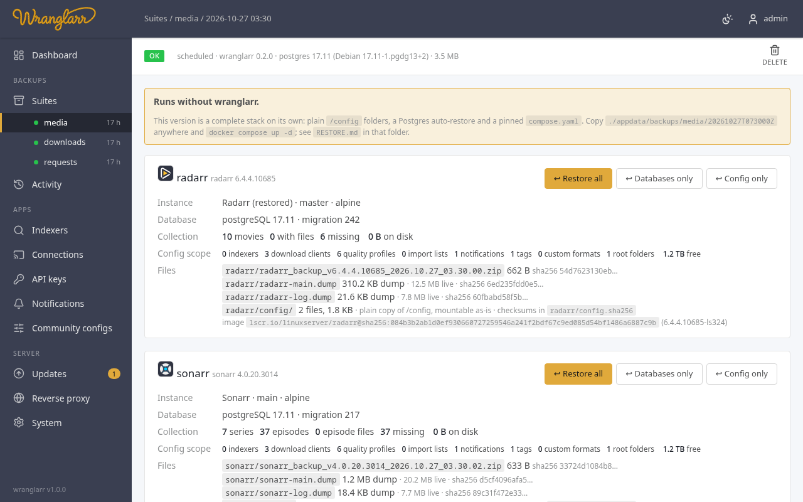</picture>
<h3>Restore per app, or without wranglarr</h3>
Restore an app's databases, its config or both, with checksums verified first. Every version also carries a pinned <code>compose.yaml</code> that restores Postgres on first start, so it runs on its own.
<br><a href="https://github.com/Wranglarrr/Wranglarr/wiki/Backups-and-Restore#without-wranglarr">Running a version on its own →</a>
</td>
</tr>
<tr>
<td width="50%" valign="top">
<picture><source media="(prefers-color-scheme: dark)" srcset="wiki/images/readme/updates-dark.png">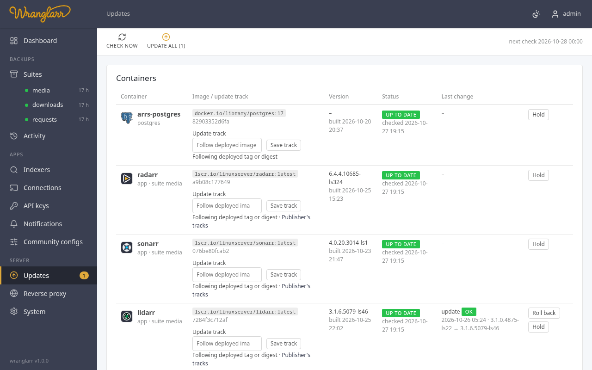</picture>
<h3>Container updates with a safety net</h3>
Checks the registries without pulling. Choose an update track per container, including wranglarr's development builds. An update backs up first, recreates the container with the same settings, waits for it to be healthy and puts the old one back if it isn't. Rollback, holds, scheduled auto-update, and no surprise Postgres major upgrades.
<br><a href="https://github.com/Wranglarrr/Wranglarr/wiki/Updates">Container updates →</a>
</td>
<td width="50%" valign="top">
<picture><source media="(prefers-color-scheme: dark)" srcset="wiki/images/readme/wizard-dark.png">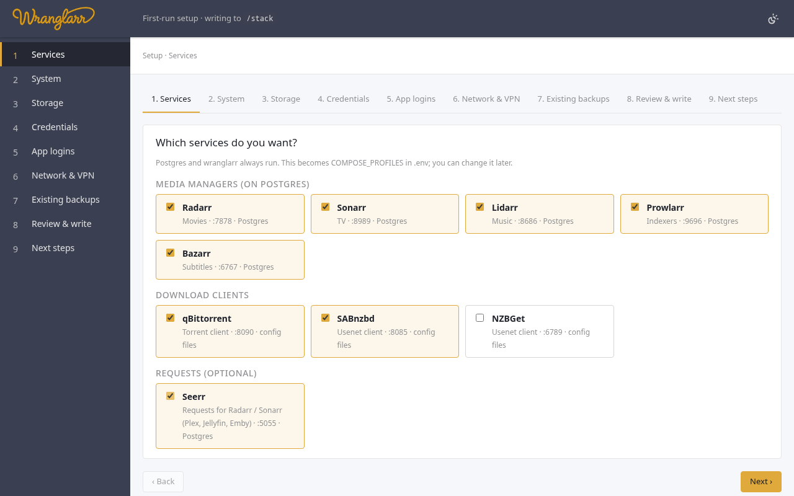</picture>
<h3>A setup wizard, not a wall of YAML</h3>
One <code>docker run</code> opens a web wizard: pick services, users, storage (checked for ownership, free space and hardlinks), VPN and logins. It writes your <code>.env</code>, then <code>init.sh</code> builds the rest.
<br><a href="https://github.com/Wranglarrr/Wranglarr/wiki/Quickstart">Quickstart →</a>
</td>
</tr>
<tr>
<td width="50%" valign="top">
<picture><source media="(prefers-color-scheme: dark)" srcset="wiki/images/readme/configs-dark.png">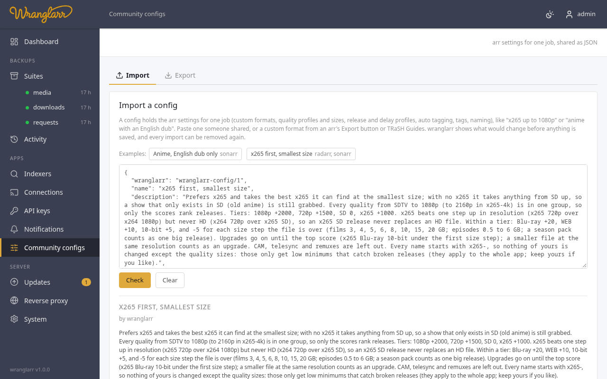</picture>
<h3>Community configs</h3>
Custom formats, quality profiles, sizes and release profiles for one job ("x265 first, smallest size", "anime, English dub only"), shared as JSON. See what changes in each arr before applying, remove it again later, test a release name, or export your own.
<br><a href="https://github.com/Wranglarrr/Wranglarr/wiki/Community-Configs">Community configs →</a>
</td>
<td width="50%" valign="top">
<picture><source media="(prefers-color-scheme: dark)" srcset="wiki/images/readme/notifications-dark.png">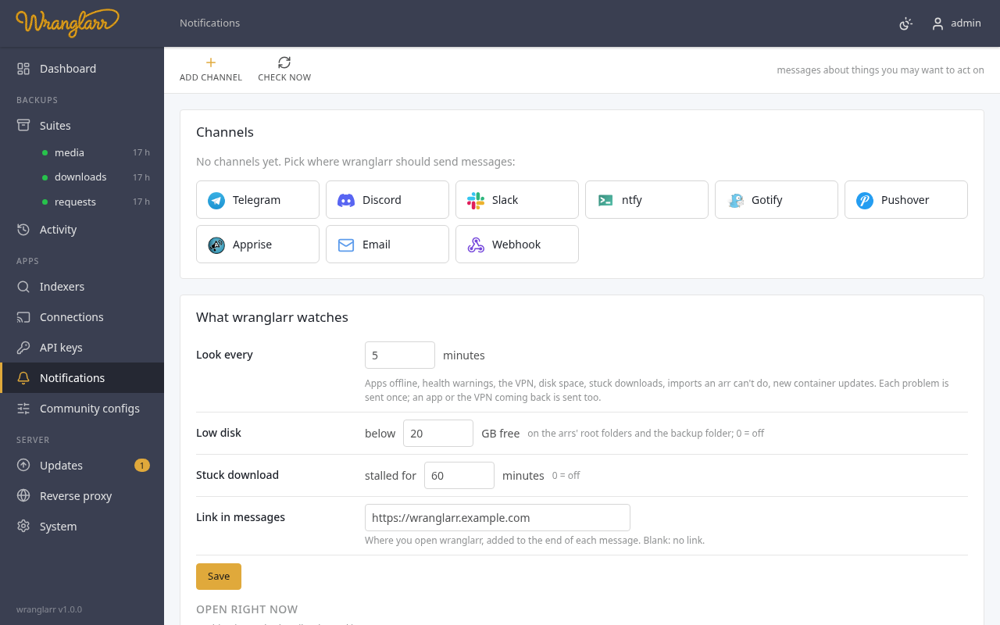</picture>
<h3>Notifications that matter</h3>
Telegram, Discord, Slack, ntfy, Gotify, Pushover, Apprise, email or a webhook. Failed backups, apps offline, VPN down, low disk, stuck downloads, imports that need you. Each problem once, and again when it clears.
<br><a href="https://github.com/Wranglarrr/Wranglarr/wiki/Notifications">Notifications →</a>
</td>
</tr>
<tr>
<td width="50%" valign="top">
<picture><source media="(prefers-color-scheme: dark)" srcset="wiki/images/readme/connections-dark.png">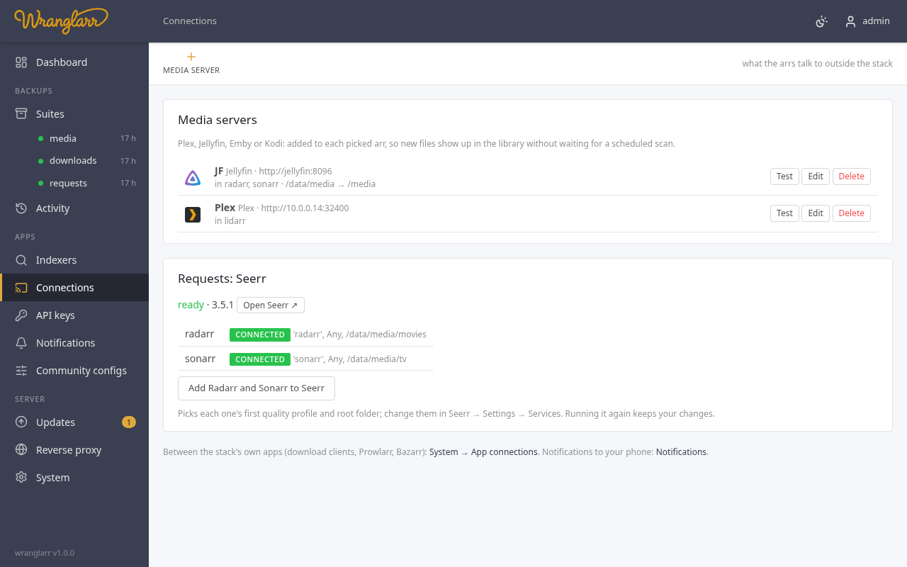</picture>
<h3>Media servers and Seerr</h3>
Plex (sign in with Plex), Jellyfin, Emby and Kodi are added to the arrs so the library rescans after each import, with path mapping. Seerr gets every Radarr and Sonarr once its own setup is done.
<br><a href="https://github.com/Wranglarrr/Wranglarr/wiki/Connections">Connections →</a>
</td>
<td width="50%" valign="top">
<picture><source media="(prefers-color-scheme: dark)" srcset="wiki/images/readme/indexers-dark.png">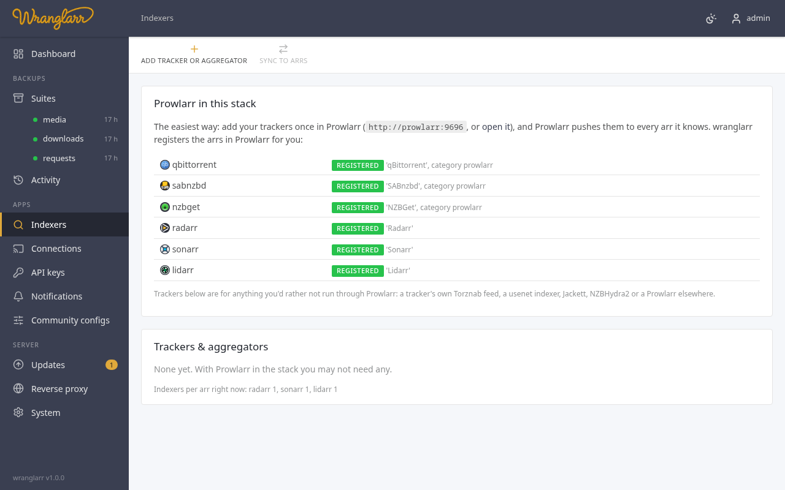</picture>
<h3>Indexers in one place</h3>
Prowlarr is registered in every arr for you. Trackers, usenet indexers, Jackett, NZBHydra2 or a Prowlarr outside the stack go to the arrs you pick, and come out again when you remove them.
<br><a href="https://github.com/Wranglarrr/Wranglarr/wiki/Indexers">Indexers →</a>
</td>
</tr>
<tr>
<td width="50%" valign="top">
<picture><source media="(prefers-color-scheme: dark)" srcset="wiki/images/readme/proxy-dark.png">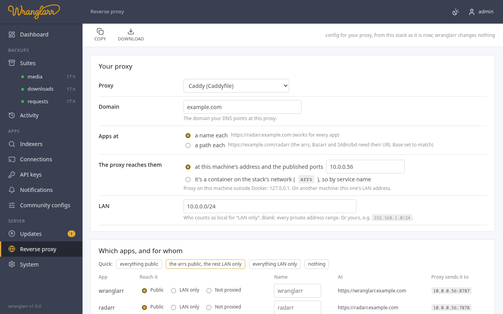</picture>
<h3>Reverse-proxy config, written for you</h3>
Caddy, nginx, Traefik, caddy-docker-proxy, Cloudflare Tunnel or Nginx Proxy Manager, generated from the stack as it is. Each app at a name of its own, a path under wranglarr's, or direct IP, public or local only, set on the dashboard with the links. Wranglarr itself can also live at a path such as `https://myhouse.com/wranglarr` (`WRANGLARR_URL_BASE=/wranglarr`), with app paths alongside it.
<br><a href="https://github.com/Wranglarrr/Wranglarr/wiki/Reverse-Proxy">Reverse proxy →</a> · <a href="https://github.com/Wranglarrr/Wranglarr/wiki/Remote-Access">Tailscale and Cloudflare →</a>
</td>
<td width="50%" valign="top">
<picture><source media="(prefers-color-scheme: dark)" srcset="wiki/images/readme/account-dark.png">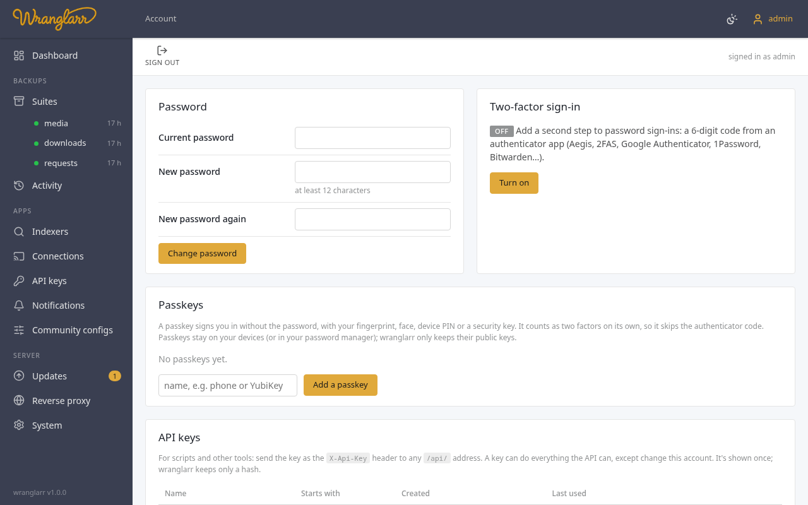</picture>
<h3>A real login, built in</h3>
Password, two-factor (any authenticator app) with recovery codes, and passkeys, with no identity provider to run. API keys for scripts. Optional <b>AuthTunnel</b> puts every app behind the same sign-in.
<br><a href="https://github.com/Wranglarrr/Wranglarr/wiki/Login">Login →</a> · <a href="https://github.com/Wranglarrr/Wranglarr/wiki/App-Logins">App logins →</a>
</td>
</tr>
</table>

### Light, dark, and your phone

<table>
<tr>
<td align="center" width="25%">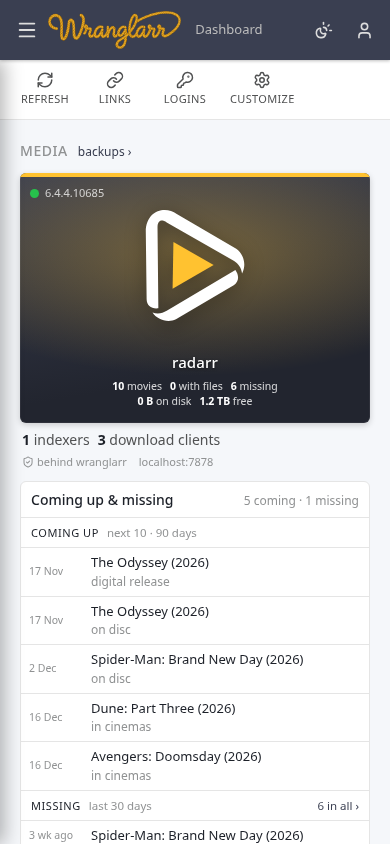</td>
<td align="center" width="25%">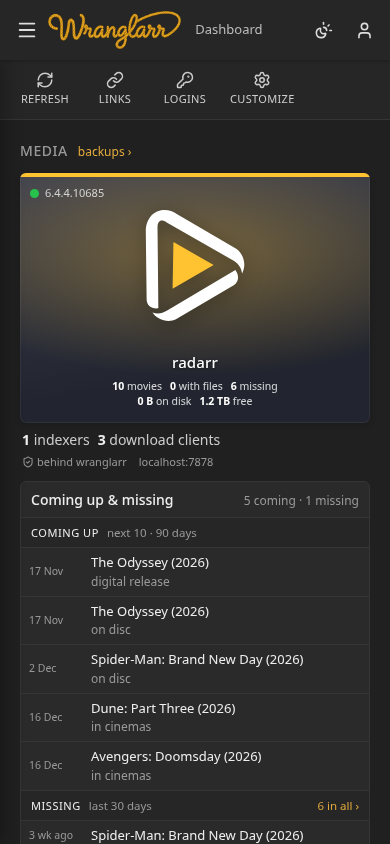</td>
<td valign="middle">
The UI looks like the arrs you already know: dark header, sidebar, page toolbar. The theme follows your system, or switch it from the header. On a phone the sidebar becomes a menu drawer.
<br><br>
<a href="wiki/images/readme/dashboard-light.png">Full dashboard, light</a> · <a href="wiki/images/readme/dashboard-dark.png">Full dashboard, dark</a>
</td>
</tr>
</table>

### Also in the box

| | |
| --- | --- |
| **VPN** | One gluetun tunnel (WireGuard or OpenVPN, any provider) for the download clients, Prowlarr or every app, with a kill switch. Tunnel state, public IP and forwarded port in the header. Or a tunnel per app with hotio images. [Shared tunnel](https://github.com/Wranglarrr/Wranglarr/wiki/VPN-Shared-Tunnel) · [Per app](https://github.com/Wranglarrr/Wranglarr/wiki/VPN-Per-App) |
| **App connections** | Every download client in every arr and in Prowlarr (category = the app's name, folders created first), Sonarr and Radarr in Bazarr, every arr in Prowlarr. [App connections](https://github.com/Wranglarrr/Wranglarr/wiki/App-Connections) |
| **Live status** | The arrs and Prowlarr tell wranglarr when something changes, and open pages update on their own. Every app's API key is on one page, and a key changed by hand is picked up: the apps using it are reconnected. [Live status](https://github.com/Wranglarrr/Wranglarr/wiki/Live-Status) |
| **App logins** | The same login set in every app, or AuthTunnel: sign in once to wranglarr and the apps let you through. API keys still pass, so the arrs' mobile apps keep working. [App logins](https://github.com/Wranglarrr/Wranglarr/wiki/App-Logins) |
| **Shared settings** | Define a download client, indexer or notification once and push it to every arr by name. [Shared settings](https://github.com/Wranglarrr/Wranglarr/wiki/Shared-Settings) |
| **Bring your apps** | Move the Radarr, Sonarr, Prowlarr, Bazarr or Seerr you already run into the stack and keep the library and history. [Bringing in existing apps](https://github.com/Wranglarrr/Wranglarr/wiki/Importing-Existing-Apps) |
| **HTTP API** | Everything the UI does is a JSON call, with API keys for scripts and cron jobs. [API reference](https://github.com/Wranglarrr/Wranglarr/wiki/API) |
| **Locked down** | wranglarr runs as your user with no capabilities on a read-only image. [Security](https://github.com/Wranglarrr/Wranglarr/wiki/Security) |

## Quick start

You need Docker with Compose 2.24+ (or rootless Podman) and Bash 4+ for `init.sh` (WSL on Windows; `brew install bash` on macOS).

**1. Get the stack**

```sh
git clone https://github.com/Wranglarrr/Wranglarr arrs && cd arrs
```

**2. Run the wizard** and open the link it prints (`http://localhost:8788/?t=…`)

```sh
docker run --rm -it -p 8788:8788 \
  -v "$PWD":/stack \
  -v /mnt/data:/data \
  ghcr.io/wranglarrr/wranglarr:latest wranglarr-setup
```

Mount the drive your media lives on as `/data` so the wizard can check it. PowerShell: `-v ${PWD}:/stack -v D:\media:/data`.

**3. Start everything**

```sh
./scripts/init.sh
```

Then open wranglarr at http://your-host:8787. After that it's plain `docker compose up -d` / `down`.

> **New here?** The [Quickstart](https://github.com/Wranglarrr/Wranglarr/wiki/Quickstart) walks through every step with screenshots. On TrueNAS SCALE, read [TrueNAS SCALE](https://github.com/Wranglarrr/Wranglarr/wiki/TrueNAS) first. Prefer no wizard? Copy `.env.example` to `.env`, fill in `DATA_ROOT`, `POSTGRES_PASSWORD`, `TZ`, `PUID`/`PGID` and `COMPOSE_PROFILES`, then run `./scripts/init.sh`.

## What's in the stack

| Service | Port | What it does |
| --- | --- | --- |
| **wranglarr** | 8787 | backups, restore, updates, dashboard, everything on this page |
| Radarr · Sonarr · Lidarr | 7878 · 8989 · 8686 | movies · TV · music, on Postgres |
| Prowlarr | 9696 | indexers for every arr, on Postgres |
| Bazarr | 6767 | subtitles, on Postgres |
| qBittorrent · SABnzbd · NZBGet | 8090 · 8085 · 6789 | download clients |
| Seerr | 5055 | requests (Plex, Jellyfin, Emby), on Postgres |
| Postgres 17 | – | one database server for all of them |
| gluetun | – | optional VPN tunnel |

Every service except Postgres and wranglarr is opt-in (`COMPOSE_PROFILES`). One `/data` mount everywhere, so imports are hardlinks, not copies.

```
 LAN ──▶ 7878 8989 8686 9696 6767 │ 8090 8085 6789 │ 5055 │ 8787
          ┌───────────────────────┴────────────────┴──────┴─────────────┐
          │  radarr  sonarr  lidarr  prowlarr  bazarr   qbittorrent sabnzbd nzbget   seerr
          │     └───────┴───────┴───────┴────────┴────────────────────────────────┴──▶ postgres:17  (one db cluster)
          │  wranglarr ──▶ app APIs · pg_dump/pg_restore · docker.sock
          │        └──▶ appdata/backups/<suite>/<version>/…
          └── optional: one gluetun WireGuard/OpenVPN tunnel for every app, or just the download clients (+ Prowlarr)
```

More in [Architecture](https://github.com/Wranglarrr/Wranglarr/wiki/Architecture).

## Documentation

**Read it as a website:** [wranglarrr.github.io/Wranglarr](https://wranglarrr.github.io/Wranglarr/), with navigation, search and dark mode. It renders this README and the [wiki](https://github.com/Wranglarrr/Wranglarr/wiki).

| Getting started | Using it | Reference |
| --- | --- | --- |
| [Quickstart](https://github.com/Wranglarrr/Wranglarr/wiki/Quickstart) | [Dashboard](https://github.com/Wranglarrr/Wranglarr/wiki/Dashboard) | [Architecture](https://github.com/Wranglarrr/Wranglarr/wiki/Architecture) |
| [Setup](https://github.com/Wranglarrr/Wranglarr/wiki/Setup) | [Backups and restore](https://github.com/Wranglarrr/Wranglarr/wiki/Backups-and-Restore) | [Environment variables](https://github.com/Wranglarrr/Wranglarr/wiki/Environment-Variables) |
| [TrueNAS SCALE](https://github.com/Wranglarrr/Wranglarr/wiki/TrueNAS) | [Container updates](https://github.com/Wranglarrr/Wranglarr/wiki/Updates) | [HTTP API](https://github.com/Wranglarrr/Wranglarr/wiki/API) |
| [Bringing in existing apps](https://github.com/Wranglarrr/Wranglarr/wiki/Importing-Existing-Apps) | [App connections](https://github.com/Wranglarrr/Wranglarr/wiki/App-Connections) | [Security](https://github.com/Wranglarrr/Wranglarr/wiki/Security) |
| [Login](https://github.com/Wranglarrr/Wranglarr/wiki/Login) | [Indexers](https://github.com/Wranglarrr/Wranglarr/wiki/Indexers) | [Troubleshooting](https://github.com/Wranglarrr/Wranglarr/wiki/Troubleshooting) |
| [App logins](https://github.com/Wranglarrr/Wranglarr/wiki/App-Logins) | [Community configs](https://github.com/Wranglarrr/Wranglarr/wiki/Community-Configs) | [Postgres](https://github.com/Wranglarrr/Wranglarr/wiki/Service-Postgres) |
| [VPN: shared tunnel](https://github.com/Wranglarrr/Wranglarr/wiki/VPN-Shared-Tunnel) | [Notifications](https://github.com/Wranglarrr/Wranglarr/wiki/Notifications) | [Radarr, Sonarr, Lidarr](https://github.com/Wranglarrr/Wranglarr/wiki/Service-Radarr-Sonarr-Lidarr) |
| [VPN: per app](https://github.com/Wranglarrr/Wranglarr/wiki/VPN-Per-App) | [Connections](https://github.com/Wranglarrr/Wranglarr/wiki/Connections) | [Prowlarr](https://github.com/Wranglarrr/Wranglarr/wiki/Service-Prowlarr) · [Bazarr](https://github.com/Wranglarrr/Wranglarr/wiki/Service-Bazarr) |
| [Remote access](https://github.com/Wranglarrr/Wranglarr/wiki/Remote-Access) | [Reverse proxy](https://github.com/Wranglarrr/Wranglarr/wiki/Reverse-Proxy) | [qBittorrent](https://github.com/Wranglarrr/Wranglarr/wiki/Service-qBittorrent) · [SABnzbd](https://github.com/Wranglarrr/Wranglarr/wiki/Service-SABnzbd) · [NZBGet](https://github.com/Wranglarrr/Wranglarr/wiki/Service-NZBGet) |
| | [Shared settings](https://github.com/Wranglarrr/Wranglarr/wiki/Shared-Settings) | [Seerr](https://github.com/Wranglarrr/Wranglarr/wiki/Service-Seerr) · [wranglarr](https://github.com/Wranglarrr/Wranglarr/wiki/Service-wranglarr) |
| | | [Development](https://github.com/Wranglarrr/Wranglarr/wiki/Development) |

<details>
<summary><b>Repository layout</b></summary>

```
compose.yaml                 the stack
compose.init.yaml            first run only: generate + patch config.xml (via scripts/init.sh)
compose.vpn.yaml             optional: shared gluetun tunnel for the download clients
compose.vpn-prowlarr.yaml    add-on to it: Prowlarr in the tunnel too
compose.vpn-all.yaml         add-on to it: every app in the tunnel
compose.vpn-per-app.yaml     optional: hotio images, one tunnel per app
compose.authtunnel.yaml      AuthTunnel only, generated by init.sh: the apps' ports go to wranglarr-gate
gate/                        wranglarr-gate's nginx.conf (its per-app servers are generated by init.sh)
.env.example                 every option, commented
postgres/initdb/             creates the databases
scripts/init.sh              bootstrap
scripts/patch_config.py      inserts the Postgres keys into config.xml
scripts/patch_downloads.py   points the download clients' save paths at /data; writes qBittorrent's login
scripts/authtunnel.sh        writes compose.authtunnel.yaml and the gate's config (sourced by init.sh)
wranglarr/                   the app, a Rust workspace; the image ghcr.io/wranglarrr/wranglarr is built from it
tests/                       the black-box suite, run against the built binary
.github/workflows/rust.yml   checks and tests
.github/workflows/image.yml  builds, smoke-tests (amd64 + arm64) and publishes the image
scripts/smoke-image.sh       the image smoke test CI runs on each platform
wiki/                        documentation; .github/workflows/wiki.yml copies it to the GitHub wiki (scripts/build-wiki.py)
site/                        docs website (renders README + wiki); .github/workflows/pages.yml publishes it
assets/brand/                logo and wordmark originals; build.py makes the sized copies
```

How the code is organized, and how to build, test and add a service: [Development](https://github.com/Wranglarrr/Wranglarr/wiki/Development).

The docs site is published by the `pages` workflow whenever the docs change (on GitHub: Settings → Pages → Source: *GitHub Actions*). To preview it locally, run `python3 site/serve.py` and open http://127.0.0.1:8000.

The [GitHub wiki](https://github.com/Wranglarrr/Wranglarr/wiki) is a copy of `wiki/`, rebuilt by the `wiki` workflow on each change, so edit the pages in `wiki/`: edits made in the Wiki tab are replaced.
</details>

<details>
<summary><b>Project status and testing</b></summary>

1.0.0 is the first release. What it brings is in the [release notes](https://github.com/Wranglarrr/Wranglarr/wiki/Release-Notes).

**Tested against mocks.** Everything has been run end to end against mock Radarr, Bazarr, qBittorrent, SABnzbd, NZBGet and gluetun servers with fake Postgres tools. That covers backups, restores, retention, shared sync, the restore plan, every page and the wizard. Container updates were run against a mock Docker Engine API that enforces the daemon's create-time conflict rules.

**Tested for real.** The full stack has run under rootless Podman 6 with docker-compose 5. That covers init, the arrs and Bazarr on Postgres, backups, restores, a real image update, and a version started without wranglarr. The screenshots on this page come from a fresh install.

**Not tested yet.** A real Docker Engine run, and a real TrueNAS SCALE install.

What's planned next is in the [roadmap](ROADMAP.md).

Upstream guides this follows:
- [servarr Postgres guide](https://wiki.servarr.com/radarr/postgres-setup)
- [Bazarr's Postgres guide](https://wiki.bazarr.media/Additional-Configuration/PostgreSQL-Database/)
- [gluetun wiki](https://github.com/qdm12/gluetun-wiki)
- [hotio's container docs](https://hotio.dev/containers)
</details>

## License

GPL-3.0-or-later. See [LICENSE](LICENSE). Radarr, Sonarr, Lidarr and Bazarr, whose backup conventions and APIs this builds on, are GPL-3.0 as well. Service icons are from [dashboard-icons](https://github.com/homarr-labs/dashboard-icons) (Apache-2.0).
