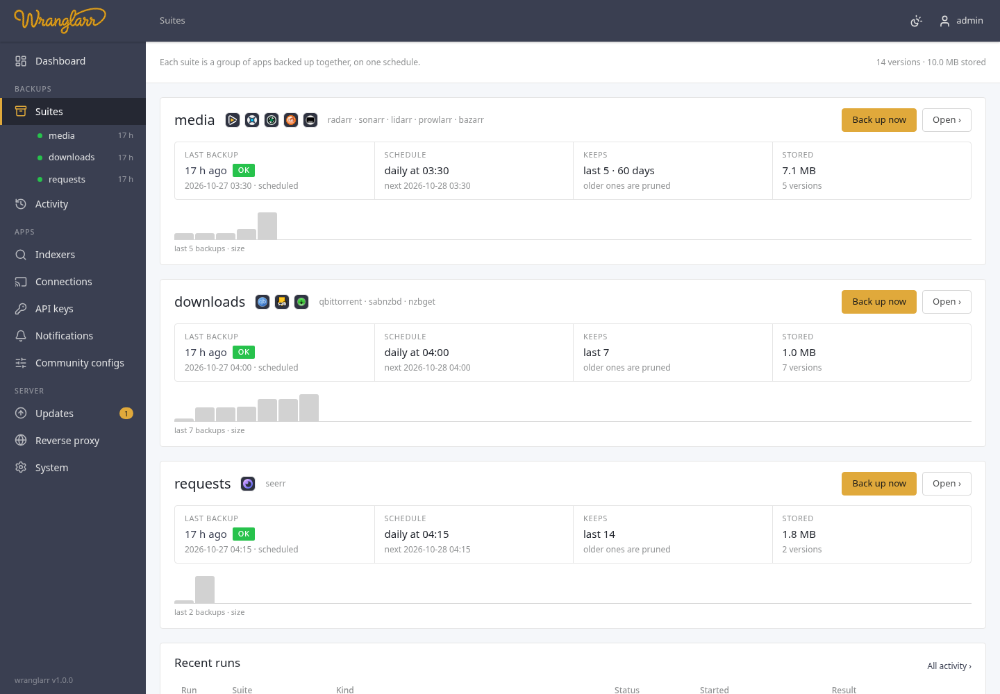
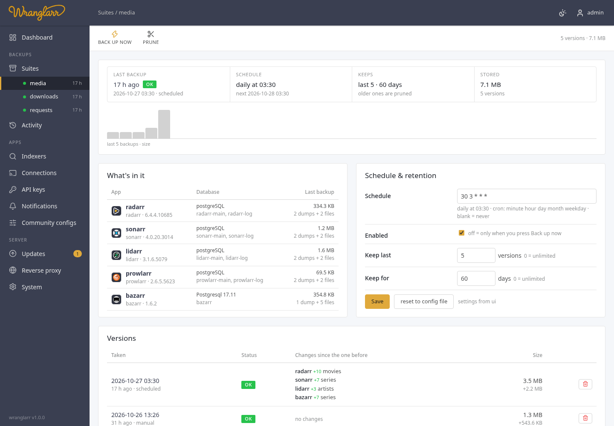

# Backups and restore

## Suites and versions

A **suite** is a group of apps backed up together with one schedule and one
retention policy (`[[suite]]` in `wranglarr.toml`; the example has `media`
and `downloads`). Each backup run produces a **version**:

```
appdata/backups/<suite>/<YYYYMMDDTHHMMSSZ>/
├── manifest.json
├── RESTORE.md                          how to run this version without wranglarr
├── compose.yaml, .env                  standalone stack, images pinned to what was running
├── postgres/initdb/10-restore.sh       stock postgres image restores the dumps on first start
├── globals.sql                         pg_dumpall --globals-only (roles)
├── radarr/config/                      Radarr's /config as-is (config.xml, asp/ keys, …)
├── radarr/config.sha256                sha256sum -c format
├── radarr/radarr.dump             pg_dump -Fc per database
├── radarr/radarr-log.dump
├── radarr/radarr_backup_v5…zip         the app's own Backup task output (config.xml)
├── prowlarr/…                          Prowlarr: the same files as an arr
├── bazarr/config/                      Bazarr's /config (config/config.yaml, …)
├── bazarr/bazarr.dump
├── bazarr/bazarr_backup_v1…zip
└── qbittorrent/config/                 qBittorrent's /config (qBittorrent.conf, BT_backup/, …)
```

Every app's `config/` folder is its `/config` in the app's own layout, so it
can be mounted back as `/config` as-is. Left out:

| App | Left out |
| --- | --- |
| arrs | `logs/`, `Backups/`, `MediaCover/` (poster cache, re-downloaded), `UpdateLogs/`, `Sentry/`, live SQLite files |
| Prowlarr | as the arrs, plus the files directly in `Definitions/` (indexer definitions it downloads on start, about 5 MB); `Definitions/Custom/`, your own definitions, is kept |
| Bazarr | `log/`, `backup/`, `cache/`, `restore/`, live SQLite files |
| qBittorrent | `logs/`, `GeoDB/` (re-downloaded), `lockfile` |
| SABnzbd | `logs/` |
| NZBGet | `nzbget.log*` |
| Seerr | `logs/`, `cache/`, live SQLite files |

On every app, `*.pid`, `*.lock` and `*.log` files are skipped too. Live
SQLite files are never copied, because copying one while the app writes to
it can tear it. On Postgres they're unused leftovers from the first start. An
arr or Bazarr in SQLite mode gets the consistent copy from its own backup
zip, laid over the folder. Seerr has no supported SQLite backup here: a Seerr
entry without a configured PostgreSQL database is marked incomplete. Run
Seerr on PostgreSQL and list its database in wranglarr, or back up its SQLite
database separately while Seerr is stopped. The Seerr status API does not report
the database engine; ensure the configured database matches the running app.

### Download clients: torrents and NZBs, not data

A download client's backup holds the torrents and NZBs themselves, not what
they downloaded:

| Client | In the backup |
| --- | --- |
| qBittorrent | the `.torrent` file of every torrent plus its resume data (`BT_backup/`: progress, save path, category, tags), and the settings |
| SABnzbd | the queue and history, a copy of every NZB added (`nzb_backup_dir`, set to `nzb-backup` by `init.sh`), NZBs in a watched folder inside `/config`, and the settings. If `download_dir` is inside `/config`, only each job folder's `__ADMIN__` (its NZB) is kept |
| NZBGet | the queue (`QueueDir`: each job's NZB and download state) and incoming NZBs (`NzbDir`) when they are inside `/config`, and the settings |

Download folders that sit inside `/config` are left out. The downloaded files
live on the shared `/data` mount (`/data/torrents`, `/data/usenet`), the same
disk as the media, so they belong to your normal file backups. A client's
backup is a few kilobytes per torrent or NZB, however large the download.
After a restore, torrents re-check the data still on `/data` and carry on (or
download again if it is gone); an interrupted usenet job can be added again
from its saved NZB.

The `downloads` suite page has a **What a downloads backup holds** panel:
per client, the counts in the newest version (torrent files, resume files,
NZB copies, queued jobs) and the paths that are not in it.

`manifest.json` records, per app: kind, version, database type and
migration version, instance name, the **collection snapshot** (movies /
series / artists, files, missing, bytes on disk; Bazarr: series, movies,
wanted; download clients: torrents or queue, history), the **configuration
scope** (indexers, download clients, quality profiles, custom formats, import
lists, notifications, tags, root folders + free space), live database sizes,
and the sha256 of every file. Plus the Postgres server version and the VPN
state at the time. The manifest is the source of truth: the store can be
copied elsewhere and still be understood.

Why both halves: on Postgres the arrs' own backup contains only `config.xml`
and skips the database; `pg_dump` knows nothing about `config.xml`.

## The Suites pages

**Suites** in the sidebar lists every suite with its apps' logos, then four
facts: the **last backup** (how long ago, and OK, partial or failed), the
**schedule** in words ("daily at 03:30") with the next run, what the
retention **keeps**, and how much is **stored**. Below that a bar per backup,
the last 30, as high as the backup is big: a partial or failed one is orange
or red with a **!**. Point at a bar for its date and size; click it to open
that version. Under the sidebar's **Suites**, each suite has a dot (green: last
backup OK, orange: partial, red: failed, pulsing: running now) and its age.



A suite's own page adds:

- **What's in it**: each app, its version, its database and what the newest
  backup holds for it (dumps and config files, and their size).
- **Schedule & retention**, editable.
- **Versions**: each backup with **what changed since the one before**: an
  app upgraded (`lidarr 3.1.0.4875 → 3.1.6.5079`), more or fewer films,
  series or torrents, an app added or left out, an error. The size and how
  much it grew or shrank.
- **Other runs**: restores, syncs and anything that failed. Each successful
  backup is already a version, so it isn't listed twice.



## Triggering

- **Backup now** on the Suites page / a suite's page, or `POST /api/suites/{s}/backup`.
- **Schedule**: cron per suite, in the container's `TZ`, editable in the UI (overrides the config file; "reset to config file" undoes it). Missed runs within an hour are run on startup.
- Runs are serialised (one at a time) and logged; the run page streams the log.

## Retention

`keep_last` (number of versions) and `keep_days` (age) per suite; `0` means
unlimited. Pruning runs after every backup and on **Prune** / `POST
/api/suites/{s}/prune`.

Only good versions (status OK) count, so a run of failed backups never pushes
a good one out:

- the newest good version always stays, however old it is;
- a failed, partial or unfinished version is removed once a newer good version
  exists, and kept until then. The version list shows **deltas** against the
previous version: an app upgrade (⬆) and the change in the primary count
(+12 movies).

## Restore

Per app, per version: databases, config, or both. Every file is checksum-
verified against the manifest first.

| App type | Databases | Config |
| --- | --- | --- |
| arrs | `pg_restore --clean --if-exists --single-transaction` into each database (created if missing). Docker control and `container` are required: the app must be confirmed stopped before any database write. A failed stop aborts the restore. It is restarted after success only if it was running before. | zip uploaded to `system/backup/restore/upload`, then the app is restarted to apply `config.xml`. The restored `config.xml` keeps this stack's Postgres connection (host, port, user and password, read from the app's current `config.xml`), so a backup from another install doesn't bring back that install's password; the database names stay as backed up. A changed API key is picked up again from the config file. |
| Bazarr | same | `config.yaml` written into the mounted config dir (previous kept as `config.yaml.pre-wranglarr`), Bazarr restarted via API, because Bazarr's own restore refuses a zip without `bazarr.db` |
| qBittorrent, SABnzbd, NZBGet | — | the version's `<app>/config/` is verified and staged **with the container stopped** (Docker control required). Every file must appear in the checksum list; extra files, links and special files are refused. Previous contents are retained in a unique recovery folder. |

Config-directory restores stage all incoming files before replacing live entries. A complete recovery copy is retained beside the config directory as `<config-dir>.pre-wranglarr` (later restores use unique suffixes), or under `WRANGLARR_PRE_RESTORE` when the parent is not writable. These recovery copies are never overwritten automatically; remove old copies only after verifying the restored application.

A failed installation attempts to put the original entries back. A failed database or file restore leaves the container stopped; inspect the run log before starting it. If wranglarr is interrupted during file installation, `.wranglarr-restore-transaction/recovery.json` inside the config directory identifies the complete recovery copy and original/replacement entries. Keep the application stopped, restore the original config from that copy, then remove the transaction directory before retrying. Its presence prevents a subsequent restore from overwriting unresolved recovery data. Replacement uses renames within the mounted config filesystem; it does not fall back to a destructive cross-filesystem copy.

API config restores are successful only after the application becomes ready again. A timeout is a failed run even when the upload succeeded.

## Restore plans

The setup wizard writes `appdata/wranglarr/restore-plan.json` listing
`app@version` items to restore after a fresh install. wranglarr shows them
as a banner with **Run plan** (one run restores each item, databases + config)
and **Discard**. Items whose version is missing from the store are shown as
such and retained as pending work. Each successful item is removed from the plan immediately, so retrying does not repeat completed restores. A run with unavailable or failed items reports partial/failed status and preserves those items. A failure stops the plan because some writes may already have completed. Failed and interrupted items remain marked and block automatic replay: inspect its run and application, then discard the plan and restore any remaining items individually.

## Without wranglarr

Every version is a complete stack on its own. If wranglarr is gone, broken
or never coming back:

```sh
cp -a appdata/backups/media/20261026T093520Z ~/arrs-restored   # work on a copy
cd ~/arrs-restored
sha256sum -c --quiet */config.sha256 && echo "configs intact"
docker compose up -d                                            # or: podman compose up -d
```

What happens on `up`:

- **Postgres** starts on an empty `postgres/data` and runs
  `postgres/initdb/10-restore.sh`, which creates each database and
  `pg_restore`s its dump. Its healthcheck uses TCP, so it only passes once
  the restore is done.
- **The apps** wait for that, then start on their own `config/` folders with
  the same API keys, settings and database contents. The images are pinned
  by digest to the ones that were running, and can be overridden with
  `RADARR_IMAGE=…` etc. in `.env`.
- **`.env`** holds the Postgres login the apps' configs expect, `PUID` /
  `PGID` / `TZ` / `UMASK`, and the host data paths as they were mounted
  (`DATA_ROOT=…`). Fix those if the data moved.
- **Apps that ran behind a VPN** (the shared one, or their own with per-app
  VPN) are put in a `downloads` profile, because the tunnel isn't part of
  this stack. They only start with `docker compose --profile downloads up -d`,
  and then without a VPN.
- **Apps that were behind AuthTunnel** have no login of their own (the gate
  did that). They're published on `127.0.0.1` only, so open them from the
  same machine, or give each one a login in its settings before changing
  the port to `8989:8989` style.
- **Suites without databases** join the `arrs-restore` network created by
  the one with Postgres. Start that one first, or `docker network create arrs-restore`.

Each version's `RESTORE.md` repeats this with its own versions and file list.

This was tested by backing up a live stack, copying the version folder out
and starting it with plain `podman compose`. Radarr, Sonarr, Lidarr and
Bazarr came back on Postgres with their tags, instance names and API keys.

Single pieces work too: `docker run -v "$PWD/radarr/config:/config" …` on
the same image, `pg_restore -d radarr --no-owner radarr/radarr.dump`
with any Postgres client, `unzip` for the apps' own zips.
`globals.sql` has the roles if you move to a new cluster by hand.

## Pre-update versions

[Container updates](Updates.md) back up the affected suite before replacing a
container. Those versions carry trigger `pre-update`. Restore one if an app
migrated its database on a new version and you roll the app back. They count
towards retention like any other version.
