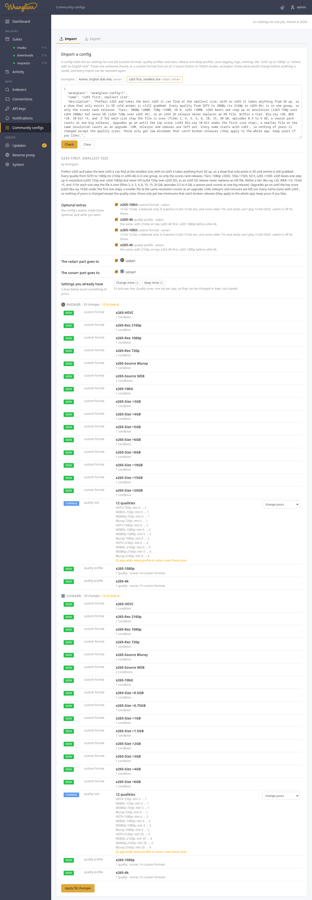
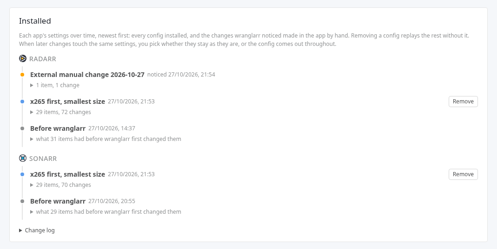
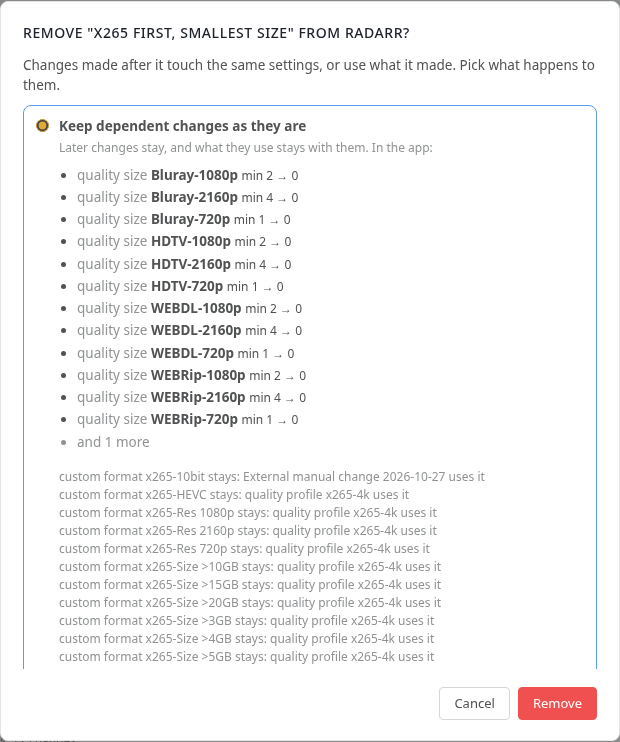
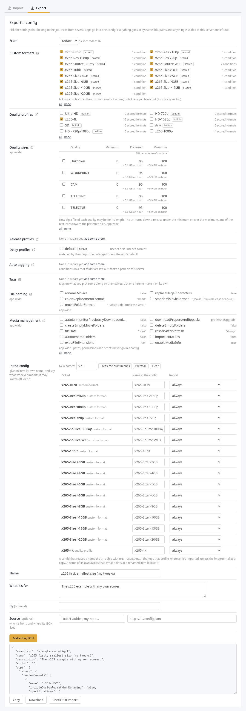

# Community configs

Setting up an arr for one job takes custom formats, a quality profile that
scores them, quality sizes, and sometimes release profiles, a delay profile, a
tag or an auto tagging rule, all clicked in by hand. Two examples of such jobs:

- "x265 preferred, smallest file at the best quality, up to 1080p";
- "anime, English dub only".

A **community config** is that whole job as one JSON file. One person sets it
up once and exports it; everyone else pastes it in.

**Community configs** in the sidebar (under Apps) does three things:

- **import** a config: shows exactly what would change in each app first, and every import can be undone;
- **test** a release name against the result;
- **export** the settings for a job from your own apps.

It has two tabs. **Import** holds the import box, what's installed, and the
release-name test; **Export** holds the export form. The address keeps the open
tab (`/configs#export`).



## Importing a config

1. Paste the config into the box, or click one of the **Examples**.
2. **Check**. wranglarr reads each app the config is for and lists every item:

   | Mark | Meaning |
   | --- | --- |
   | **new** | the app doesn't have one by that name; it's added |
   | **change** | the app has one by that name and it's different; the line says how (a condition, the cutoff, a score, a size) |
   | **same** | already set up like this; left alone |
   | **problem** | it can't go into this app (an unknown quality, a condition type the app doesn't have, a score for a custom format nobody has); nothing is applied while one is listed |

   Lines marked with a warning sign need a look before you apply:

   - a profile the arr ships with (`HD-1080p`, `Any`…), or one your films or series use ("used by 733 movies");
   - a custom format your own profiles score;
   - a tag already on series, release profiles or indexers;
   - settings for the whole app: quality sizes, file naming, media management, the default delay profile;
   - a new auto tagging rule, which tags matching items in your library.

3. **Optional extras**, if the config has any, are listed first with the author's
   note on each. They're the parts of a job people disagree on: a group they
   prefer, a bonus for 10-bit. Tick or untick them; the list below follows.
   Switching off a custom format also drops the scores the config's profiles
   give it.
4. Under each part ("The radarr part goes to…"), tick the apps it goes to. With
   two Radarrs (say `radarr` and `radarr-4k`) you pick one, both or neither.
   The list updates as you tick.
5. **Settings you already have**: each line that would change something of
   yours has a choice:

   | Choice | What happens |
   | --- | --- |
   | **change yours** | the config's version replaces yours (the default) |
   | **keep yours, skip this** | yours stays; the config's is left out |
   | **add a copy** | yours stays, and the config's goes in as a copy named with a prefix (`v2 · HD-1080p`). A copy of a profile starts from yours, with the config's changes on top |

   **Change mine**, **Keep mine** and **Add copies named** set every line that
   allows it at once (the count says how many); type the prefix first. The
   rest of the config follows a copy: its profiles score the copied custom
   format, its auto tagging points at the copied profile, and a copied tag
   (`v2-anime`) goes on its release and delay profiles. Quality sizes, file
   naming and media management are one set per app, and a delay profile is
   matched by its tags: these can be changed or kept, not copied. When a
   config touches only those, **Add copies named** isn't offered.
6. **Apply**. When it's done, the check runs again and should say
   *already set up like this*.

Everything is matched by **name**: a custom format called `x265 / HEVC` in the
config updates the one called `x265 / HEVC` in the app, or is added if
there isn't one. Nothing else in the app is touched. Your other custom formats
and profiles stay, and so do the scores your existing profiles give them.

### What a config doesn't do

A config only adds and changes things. To put a profile to work:

- **Existing films and series keep their profile.** Switch them with the arr's
  mass editor (Movies or Series → Edit → select → Quality Profile), or pick the
  profile when you add new ones. A copy made on import is a new profile, so
  nothing uses it until you switch.
- **Quality sizes belong to the whole app.** Every profile in that app uses them.
  The preview reminds you when a config changes them.
- **A config can't reach anything else.** Indexers, download clients, root
  folders, paths, permissions, logins and API keys are out of its reach. It
  holds the parts listed under [The format](#the-format), and of media
  management only options that name no path. Every condition, with its
  regular expression, is visible in the JSON before you apply it.

### History and interrupted changes

History saves the previous values before each change is sent to an app. If an
apply stops partway, its partial history entry remains available for Undo. Undo
can retry changes that failed. If a create request loses its response, the app
may have created the item without returning its ID. Check the app for that item;
Undo leaves it alone and keeps the history entry until you resolve it and forget
the entry. Unfinished history entries are kept even when the normal history
limit is reached.

An interrupted removal also leaves a partial recovery entry in History. Undo can
restore replaced values, but a deleted item may need to be restored by hand:
recreating it can give it a different ID and break references. A completed
removal discards its temporary recovery entry. If an app cannot be read, removal
waits until its current settings can be verified.

### Installed: a timeline per app

wranglarr keeps each app's settings as a timeline under **Installed**, newest
first. The timeline is a list of **keyframes**: each value a config can set
(a profile's cutoff, one score, the minimum size of one quality, a whole custom
format) gets a keyframe whenever something changes it. There are three kinds of entry:

- **Before wranglarr**: what each setting was before wranglarr first changed
  it, saved the first time an install touches it.
- **A config**: what that install changed. Each one has a **Remove** button.
- **External manual change** and a date: changes made in the app itself that
  wranglarr noticed. It looks when the page opens, and before every install
  and removal. The date is the day it noticed.



#### Removing a config

Removing a config replays the timeline without it. What it changed goes back to
the value before it (another config's, or the app's own), and what it added is
deleted. A tag still used by something in the app stays.

What wranglarr asks depends on what came after it:

- **Nothing changes in the app**: it's removed straight away. For example,
  1080p was at 2, *Better 1080p* set it to 4, then you set it back to 2 by hand.
  Removing *Better 1080p* leaves 2 either way.
- **Only its own changes go back**: you get one confirmation listing them.
- **Later changes touch the same settings, or use what it made**: you pick one of two:
  - **Keep dependent changes as they are**: later changes stay. Whatever
    they use stays too, such as a custom format a profile you edited by hand still
    scores. The config stays listed as *partly removed* with what it still holds,
    and you can remove it again later.
  - **Remove its changes throughout**: its settings go back to how they were
    before it, *over* the later changes, manual ones included. The dialog
    lists each later change this overrides. Scores and fields of what it made go along with it.



Until the blast-radius checks are in (see [What's next](#whats-next)), the
removal dialog says it hasn't checked which films, series or artists use what it
changes. Changed settings apply to all of them. A profile it removes may still be
set on some. The app may refuse to delete a profile in use: it then stays, and
the removal says so. Check the library first when it matters.

#### Shared settings need an OK

Before applying, wranglarr asks you to confirm when a config changes:

- something the arr ships with (`HD-1080p`, `Any`, Lidarr's `Standard`);
- an app-wide part (quality sizes, file naming, media management);
- the default delay profile;
- settings another installed config set.

The dialog says which. Through the API, apply then needs `"ack": true`.

#### The change log

Under **Change log**, every import is listed with the copies of what it
replaced. **Undo** there puts those copies back as they were, so edits made to the same
settings since are lost. **Remove** under Installed keeps them. **Forget** only
takes a line off the log.

If an arr refuses part of an import (it goes offline half way, say), what was
already saved is still listed, marked **partly**.

## Pasting a single custom format

The box also takes a custom format on its own, or a list of them, as the arrs'
own **Export** button (Settings → Custom Formats → a format → Export) or
[TRaSH Guides](https://trash-guides.info/) give it. A bare format doesn't say
which app it's for, so you tick the apps it goes to.

TRaSH's `trash_id` and `trash_scores` fields are ignored. Set the score in
a profile, or wrap the format in a config with a `formatScores` entry.

## The examples

Both examples ship with wranglarr. Apply them as they are, or use them as a
starting point and export your own.

### x265 first, smallest size (Radarr and Sonarr)

Two quality profiles, **x265-1080p** and **x265-4k**. They take x265 whenever
it exists, the best x265 at the smallest size, and anything else when there's
no x265. Every name starts with `x265-`, so importing it changes none of your
own profiles or custom formats.

- **Qualities**: one group, *x265-any*, from SDTV, DVD and 480p through 720p
  and 1080p (and 2160p in x265-4k). Inside a group every quality counts the
  same, so only the scores below rank releases. A show that only exists in SD,
  like old anime, is still grabbed. CAM, telesync, telecine, workprints and
  remuxes are left out.
- **Scores**, in tiers:

  | Custom format | Score |
  | --- | --- |
  | `x265-HEVC` (x265, h265, h.265, HEVC) | +1000 |
  | `x265-Res 2160p` (x265-4k only) / `x265-Res 1080p` / `x265-Res 720p` | +2500 / +2000 / +1500; SD 0 |
  | `x265-Source Bluray` / `x265-Source WEB` | +20 / +10 |
  | `x265-10bit` | +5, a tiebreak only. It matches H.264 10-bit too. An optional extra: switch it off if something you watch on can't play 10-bit HEVC |
  | `x265-Size >3GB`, `>4GB`, `>5GB`, `>6GB`, `>8GB`, `>10GB`, `>15GB`, `>20GB` (films); `>0.5GB` … `>6GB` (episodes) | −5 each, so they add up: the bigger the file, the lower |

  x265 is worth more than one step of resolution but less than HD itself:
  x265 720p (2500) beats x264 1080p (2000), and x264 720p (1500) beats
  x265 SD (1000). So an SD x265 never replaces an HD file. All the size
  steps together (−40 at most) stay smaller than one resolution step, and
  only decide between releases of the same tier.
- **Upgrades** run until the top score: x265, the top resolution, Blu-ray,
  10-bit and under the first size step (3025 for x265-1080p, 3525 for x265-4k).
  An upgrade needs at least +5, one size step: a smaller x265 at the same
  resolution counts. The size formats are scored on the file you have too, so
  a 5.5 GB x265 on disk (2995) is replaced by a 2.5 GB one (3010), not by
  another 5.8 GB one.
- **Quality sizes**: only low minimums that catch broken releases, for the
  720p, 1080p and 2160p qualities (1, 2 and 4 MB per minute). They apply to the
  whole app, so the preview offers to keep yours. Sonarr ships with 35 MB per
  minute for 2160p, which turns away small x265 4K episodes. The "small" part is
  done by the size formats inside the profiles, not by these limits.
- **x265-4k** is an optional extra: the same, with 2160p on top. It's x265 4K
  first, and x265 1080p before x264 4K.

Season packs in Sonarr are one release, so the size formats see the whole
pack: a pack scores lower than single episodes of the same tier.

Then set your films or series to x265-1080p or x265-4k, as above.

### Anime, English dub only (Sonarr)

Only grabs anime releases that have an English audio track.

| Custom format | Score | Matches |
| --- | --- | --- |
| English audio | +100 | `Dubbed`, `(Dub)`, `English Dub`, `English Audio`, `Dual Audio`, `[Dual]`, `JA+EN` / `JPN+ENG` / `Japanese.English`, `Multi Audio`, `[Multi]`, and `DUAL` or `MULTi` after the resolution or source tag (so a show called *Dual!* doesn't count). Whole words only, with dots, spaces, dashes or underscores around them: `Individual` and `Multiverse` don't match |
| English dub groups | +100 | releases from Golumpa, KaiDubs, KamiFS, KS, torenter69 or Yameii, which put out English dubs even when the name doesn't say so |
| Other-language audio | −1000 | the name gives another audio language **and doesn't name English**: `PT-BR`, `Dublado`, `Latino`, `Castellano`, `VF`, `TRUEFRENCH`, `German DL`, `ITA-JAP`, `Hindi`, `German Dubbed`, `ITA Dub`… It outweighs English audio, so `Dual Audio PT-BR` or `MULTi VF` is skipped, while `Dual Audio [Hindi-English]` and `Multi-Audio ENG/GER/FRE` are kept |

Subtitles never count as English audio: `Dual-Subs`, `Multi-Sub`, `Multiple
Subtitle` and `Eng Subs` score nothing (so `Dual Audio PT-BR [Eng Subs]` is
still skipped).

The profile **Anime, English dub** has a minimum score of 100, so
subtitle-only releases (most fansubs, `[SubsPlease]`, `Eng-Subs`) are
skipped.

To use it, set each show's **Series Type** to **Anime** and its profile to
**Anime, English dub** (or set both when you add the show).

For anime films in Radarr, export the three custom formats and the profile's
scores from Sonarr, change the app key to `radarr`, and import that. The
quality names are the same.

Release names don't always say what audio they carry. Before you rely on a
config, check a few real names under **Test a release name** (below).

## Test a release name

Pick an app, paste a release name, **Test**. The arr parses it and wranglarr shows:

- the quality it reads;
- the language;
- the custom formats it matches;
- the score each of the app's quality profiles gives it, with whether that
  profile would take the release (*would take it*, *skipped: needs 100*, or
  *quality not in this profile*).

## Exporting a config

On the **Export** tab:

1. Pick an app under **From**. Everything it has that a config can hold is
   listed, part by part: custom formats, quality profiles, metadata profiles
   (Lidarr), quality sizes, release profiles, delay profiles, auto tagging,
   tags, file naming and media management. The icon next to each part's name
   opens that part's page in the app itself, in a new tab. Quality sizes come
   as a table: the minimum, preferred and maximum size for each quality (MB
   per minute of runtime; in Lidarr an average bitrate in kbit/s), with what
   that comes to for an hour. The
   app turns down a release under the minimum or over the maximum, and of the
   rest leans toward the preferred size.
2. Tick what belongs to the job. Ticking a profile ticks the custom formats it
   scores (marked *scored*); untick any you'd rather leave out, and its score
   goes too.
3. Switch to another app and tick more if you like. Picks from several apps go
   into one config, keyed by the kind of app.
4. Under **In the config**, every named item going into the config is listed:
   - **Name in the config**: give it a name of its own. An item named like
     one the arrs ship with (marked *built-in*: `HD-1080p`, `Any`…) changes
     that profile wherever it's imported, unless the importer takes a copy.
     **Prefix the built-in ones** puts the prefix in front of those names;
     **Prefix all** does every name. What points at a renamed item follows it.
   - **Import**: leave an item on *always*, or make it an extra, *on unless
     switched off* or *off unless switched on*, and say in a few words what it
     does. That note is what the importer reads next to its switch.
5. Give it a **Name** and say what it's for, then **Make the JSON**. Notes
   under the button say what was left out: a score for a custom format you
   didn't pick, an auto tagging condition on a root folder.
6. **Copy** or **Download** it. **Check it in Import** switches to the Import tab and runs the preview on it;
   against the app it came from, everything should be *same* (renamed items
   show up as *new*).



Only names and values go into the file:

- no ids;
- no root folders or other paths;
- nothing else that only makes sense on your server.

Tags, profiles and select options go in by name (`Anime`, `English`, `HD-1080p`); the
importing app creates any tag it doesn't have.

## Sharing configs

For now a config is shared as JSON: in a gist, a repository, a forum post. Whoever
uses it pastes it in.

### What's next

In this order (the whole plan is in the [roadmap](../ROADMAP.md)):

1. **Blast-radius checks.** Today neither an install nor a removal looks at
   which films, series or artists use what it changes. A removal only warns
   you about that (see below). Next:
   - show, for each profile, tag or setting a change touches, how many items
     use it, and which;
   - before a profile they use is removed, offer to move them to another one;
   - hold back a removal that would leave items on a profile that's gone.
2. **Config providers.** You'll add a repository of configs (a Git repository
   or any web address with an index file) and pick from its list on the same
   page, with updates when it changes. A config's `source` URL is where
   wranglarr will look for a newer version. The format below is what those
   repositories will hold.

## The format

```json
{
  "wranglarr": "wranglarr-config/1",
  "name": "x265 up to 1080p",
  "description": "What it does and how to use it once imported.",
  "author": "you",
  "link": "https://example.com/where-it-came-from",
  "source": {"name": "TRaSH Guides", "url": "https://example.com/x265-small.json"},
  "apps": {
    "radarr": {
      "customFormats": [
        {
          "name": "x265 / HEVC",
          "includeCustomFormatWhenRenaming": false,
          "extra": { "default": true, "note": "Only if your players handle HEVC" },
          "specifications": [
            { "name": "x265 / HEVC", "implementation": "ReleaseTitleSpecification",
              "negate": false, "required": false,
              "fields": { "value": "[xh][ ._-]?265|\\bHEVC(\\b|\\d)" } }
          ]
        }
      ],
      "qualityProfiles": [
        {
          "name": "x265 up to 1080p",
          "upgradeAllowed": true,
          "cutoff": "1080p",
          "qualities": [
            { "name": "1080p", "qualities": ["Bluray-1080p", "WEBDL-1080p", "WEBRip-1080p", "HDTV-1080p"] },
            "Bluray-720p"
          ],
          "minFormatScore": 0, "cutoffFormatScore": 100, "minUpgradeFormatScore": 1,
          "language": "Original",
          "formatScores": { "x265 / HEVC": 100 }
        }
      ],
      "qualityDefinitions": {
        "Bluray-1080p": { "min": 5, "preferred": 20, "max": 70 }
      },
      "releaseProfiles": [
        { "name": "No cams", "enabled": true, "required": [], "ignored": ["HDCAM", "TELESYNC"], "tags": ["no-cams"] }
      ]
    },
    "sonarr": {
      "tags": ["anime"],
      "delayProfiles": [
        { "tags": ["anime"], "preferredProtocol": "torrent", "usenetDelay": 0, "torrentDelay": 60 }
      ],
      "autoTags": [
        { "name": "Anime series", "tags": ["anime"], "removeTagsAutomatically": false,
          "specifications": [
            { "name": "anime", "implementation": "SeriesTypeSpecification", "fields": { "value": "Anime" } }
          ] }
      ],
      "naming": { "renameEpisodes": true },
      "mediaManagement": { "downloadPropersAndRepacks": "doNotPrefer" }
    },
    "lidarr": {
      "metadataProfiles": [ { "name": "Albums and EPs", "primaryAlbumTypes": ["Album", "EP"] } ]
    }
  }
}
```

| Key | What it is |
| --- | --- |
| `wranglarr` | always `wranglarr-config/1` |
| `name`, `description`, `author`, `link` | shown in the preview. Only `name` is needed, and `link` must be http(s) |
| `source` | optional: who the config is from and where its JSON lives, as a name, a URL, or both (`{"name", "url"}`). A plain string starting with `http(s)://` is the URL, any other the name. Shown in the preview and on the installed timeline |
| `apps` | one part per kind of app: `radarr`, `sonarr`, `lidarr`, `whisparr`. Each part holds any of the keys below |
| `tags` | tag names to create: lower-case letters, digits and dashes. Tags named anywhere else in the config are created too |
| `customFormats` | the shape the arrs' own Export button writes, so formats copied from an arr or TRaSH Guides go in as they are. `fields` may be `{"value": …}` or the API's `[{"name","value"}]`. For a choice field (source, resolution, language…), the value is the arr's number, or the label as the arr shows it (`"English"`, `"Bluray"`) |
| `qualityProfiles` | `qualities` lists the allowed qualities **best first**. A group is `{"name", "qualities": [...]}`, and its qualities count as equal. Anything not listed is not allowed. `cutoff` names a quality or a group (default: the first). `formatScores` maps custom format names to scores; formats left out keep the score the profile already gives them (0 for a new profile). `language` exists in Radarr only. Left-out keys keep the app's value |
| `qualityDefinitions` | quality name → any of `min`, `preferred`, `max`: **MB per minute** of runtime in Radarr, Sonarr and Whisparr, an average bitrate in **kbit/s** in Lidarr. `null` means no limit. These are app-wide |
| `extra` | on a custom format, quality profile, metadata profile, release profile or auto tagging rule: makes it optional. `default` is whether it's on until the importer changes it, `note` what it does (up to 300 characters). Without `extra` an item is always imported |
| `releaseProfiles` | `required` (at least one must be in the name) and `ignored` (none may be) terms, `enabled`, `tags` by name |
| `delayProfiles` | matched by their `tags`; no tags is the app's default delay profile. Any of `enableUsenet`, `enableTorrent`, `preferredProtocol` (`usenet` or `torrent`), `usenetDelay` and `torrentDelay` (minutes), `bypassIfHighestQuality`, `bypassIfAboveCustomFormatScore`, `minimumCustomFormatScore`. Lidarr lists its protocols as `items` instead |
| `autoTags` | auto tagging rules: `name`, the `tags` they add, `removeTagsAutomatically`, and `specifications` in the custom format shape. A quality profile, tag or choice is given by name (`"HD-1080p"`, `["anime"]`, `"Anime"`). Root folder conditions aren't allowed |
| `metadataProfiles` | Lidarr only: `name`, and the allowed `primaryAlbumTypes`, `secondaryAlbumTypes` and `releaseStatuses` by name. Lists left out keep the app's (a new profile starts from Lidarr's *Standard*) |
| `naming` | file naming settings by the API's names (`renameEpisodes`, `standardMovieFormat`…). App-wide |
| `mediaManagement` | a few media management options that name no path: `downloadPropersAndRepacks`, `deleteEmptyFolders`, `importExtraFiles`, `extraFileExtensions`, `fileDate`, `rescanAfterRefresh`, `enableMediaInfo`, `episodeTitleRequired`, the `autoUnmonitorPreviouslyDownloaded…` and `createEmpty…Folders` options, Lidarr's `allowFingerprinting` and `watchLibraryForChanges`. App-wide |

Quality names are the app's own and differ slightly between apps. For
example, Radarr has `Remux-1080p` where Sonarr has `Bluray-1080p Remux`. Check
a config against the app to see any it doesn't know.

The same name may not appear twice in one list. A config is at most 512 KB.

## When something goes wrong

| What you see | Why, and the fix |
| --- | --- |
| *not valid JSON: … at line N column M* | a comma or quote is off, often from copying only part of a file. Copy it again whole |
| *radarr has no quality "X"* | quality names differ between apps, or there's a typo. Use the app's name for it (Settings → Quality lists them) |
| *has no condition type "X"* | the condition only exists in the other app (Radarr's `EditionSpecification`, Sonarr's `ReleaseTypeSpecification`…). Take it out of that app's part |
| *scores custom format "X", which neither the config nor the app has* | add the custom format to the config, or remove the score |
| *has no quality profile "X"* (auto tagging) | the rule points at a profile the app doesn't have: put the profile in the config too, or make one by that name |
| *a root folder is a path on one server* | an auto tagging condition on a root folder can't be shared: take it out |
| *refused the host name* | the arr's Allowed Hosts setting: see [Troubleshooting](Troubleshooting.md) |
| a profile is set, but nothing gets grabbed | test a real release name: the score may be under the profile's minimum, or the quality not in it. Check the quality sizes too: a release over the max is refused |
