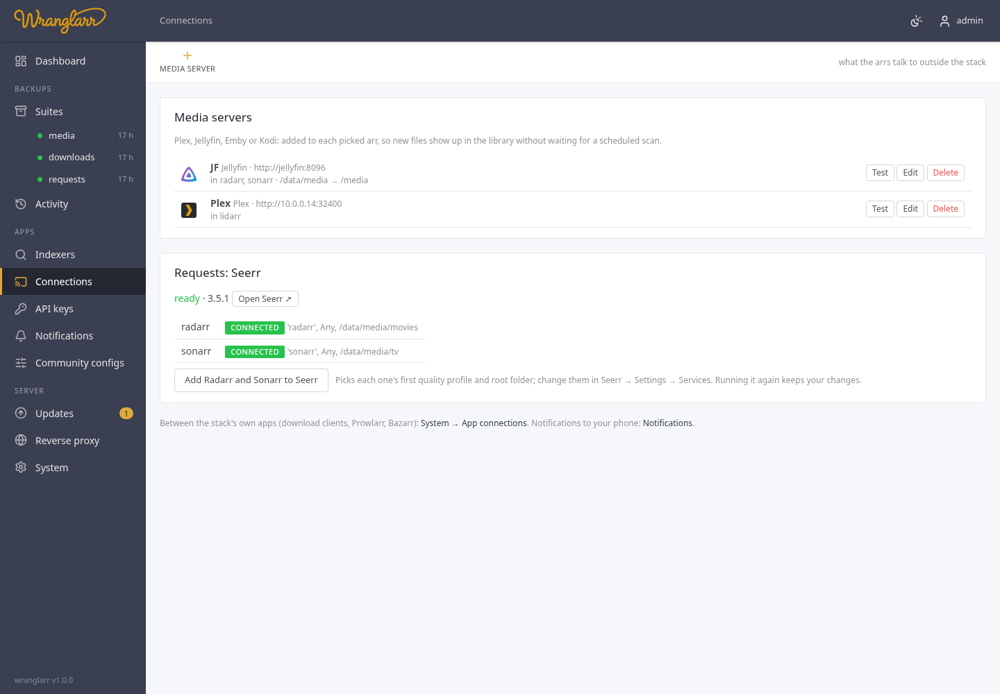

# Connections: Plex, Jellyfin, Emby, Kodi and Seerr

**Connections** in the sidebar links the stack to the apps around it:

- **Media servers.** Plex, Jellyfin, Emby or Kodi, added to the arrs so they
  tell the server to rescan after they import, upgrade, rename or delete
  something. New episodes show up in your library within seconds instead of
  at the next scheduled scan.
- **Seerr**, the request app, when its profile is on ([Service: Seerr](Service-Seerr.md)).



The connections between the stack's own apps (download clients, Prowlarr,
Bazarr) are on the System page ([App Connections](App-Connections.md)).

## Adding a media server

1. **Media server** in the toolbar, and pick Plex, Jellyfin, Emby or Kodi.
2. **Address**: how the arrs reach the server, e.g. `http://192.168.1.10:32400`
   (Plex) or `http://jellyfin:8096` when it runs on the same Docker network.
   `https://` and a path (`https://media.example.com/jellyfin`) work too.
3. The token:

   | Server | Token | Easiest way to get it |
   | --- | --- | --- |
   | Plex | Plex token | **Sign in with Plex**: a plex.tv window opens, you approve wranglarr, and the token fills in (and the address, from the servers on your account). wranglarr never sees your Plex password |
   | Jellyfin / Emby | API key | **Get a key**: enter an administrator's user and password once; wranglarr signs in, creates a key called `wranglarr-arrs`, and signs out. The password isn't kept. Or paste a key from Dashboard → API Keys |
   | Kodi | user and password | the web server login under Kodi's Settings → Services → Control |

4. **Library**, *rescan when an arr imports…*: on by default. Off keeps the entry but the arr
   won't trigger scans.
5. **Path mapping**, only when the server sees the files under a different
   path than the arrs. The arrs see `/data/media/movies/...`; if Plex runs
   elsewhere and has them at `/mnt/media/movies/...`, map `/data/media/` to
   `/mnt/media/`. Leave both blank when the paths are the same.
6. Pick the arrs under **In these arrs** (Radarr, Sonarr, Lidarr), **Test**, **Save**.

wranglarr adds an entry called `wranglarr · <name>` to each picked arr's
**Settings → Connect**, with every event that changes files switched on
(import, upgrade, rename, delete) and the rest (grab, health) off. The arr
tests the connection itself before saving. Changing the server here updates
those entries; un-picking an arr or deleting the server removes it from there.

Lidarr's Jellyfin / Emby connection has no path mapping; the path must be
the same for both.

## Seerr

When the stack runs Seerr, this page shows whether it's up, whether its
first-run setup is done, and which arrs are in it.

Seerr needs you once: open it and sign in with your Plex, Jellyfin or Emby
account. That's Seerr's own setup and makes you its administrator. Until
then wranglarr can't use its API, and the Radarr / Sonarr links show
**waiting**. wranglarr checks every 5 minutes and adds them by itself when
the setup is done.

What wranglarr sets in Seerr (Settings → Services):

- every Radarr and Sonarr in the stack, by service name and API key, tested
  by Seerr first;
- the first quality profile and root folder of each. Whatever you change
  in Seerr later is kept when Connect runs again;
- an app with `4k` in its name (`radarr-4k`) as Seerr's 4K server;
- the address you open the arr at, so Seerr's "open in Radarr" links work.

**Add Radarr and Sonarr to Seerr** on this page runs it straight away (the
same as **Connect apps** on the System page, for these links only).

An arr with no root folder yet is refused by Seerr: add one in the arr
(Settings → Media Management), then **Connect apps** on the System page.

## HTTP API

```
GET    /api/connections                  media servers (tokens masked), the arrs, and Seerr's state and links
POST   /api/connections/media            {"kind":"plex","name":"Plex","url":"http://…:32400","token":"…","update_library":true,
                                          "map_from":"","map_to":"","arrs":["radarr","sonarr"]}
PUT    /api/connections/media/{id}       same body; "••••••••" keeps the stored token
DELETE /api/connections/media/{id}       also removes it from the arrs
POST   /api/connections/media/test       {"server":{…},"id":"…"}
POST   /api/connections/plex/pin         start a Plex sign-in: {"id", "auth_url"} (open auth_url)
GET    /api/connections/plex/pin/{id}    {"done":false}, or {"done":true,"token","servers":[{"name","addresses"}]} once approved
POST   /api/connections/jellyfin/key     {"url","username","password"} -> {"token"}
```
