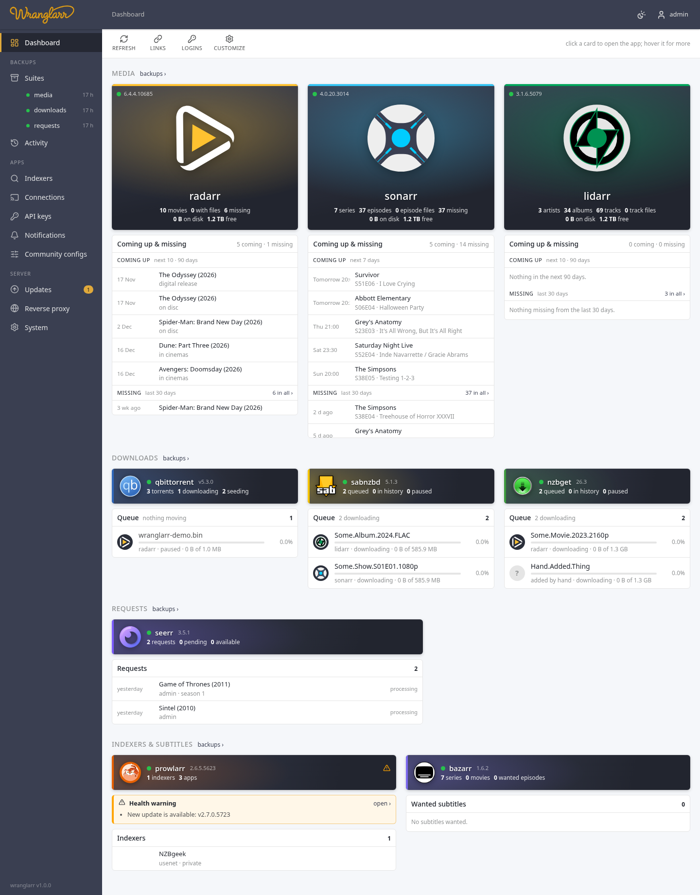
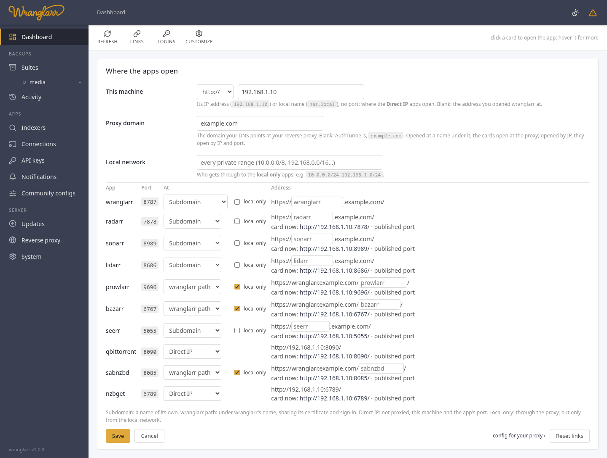

# Dashboard, app links and logins

wranglarr opens on the **Dashboard**: every app in the stack, grouped by what it does, and
under each one what it's working on:

| Group | Apps | Shown as | Underneath |
| --- | --- | --- | --- |
| Media | Radarr, Sonarr, Lidarr (Readarr, Whisparr) | a poster | coming up and recently missing, in one table |
| Downloads | qBittorrent, SABnzbd, NZBGet | a card | the client's queue |
| Requests | Seerr | a card | the latest requests |
| Indexers & subtitles | Prowlarr, Bazarr | a card | Prowlarr's indexers, Bazarr's wanted subtitles |

Click a poster or card to open that app in a new tab; click a row in a list
to open that film, series or album in the app.



## Posters and cards

Each poster or card shows the app's own logo (read from the app, so it
matches the version you run), a green or red dot for whether it answers,
and its version. A poster also shows what the arr holds (movies, files,
missing) and its disk space: used, and free in its root folders. A card
shows the two or three numbers that matter most (torrents and downloading,
queued, requests); a download client also shows its speed.

**Health warnings** are never hidden: they're listed in an orange box right
above the app's list, with **open ›** to the app's own status page. The ⚠
and its count on the poster or card say the same at a glance.

**Point at a poster or card** for the rest: its indexers and download
clients, the app's login, and the address it opens at (a card also shows
its disk space there). Prefer to see everything all the time? Set **Card
details** to *always* under System → Dashboard. On a touch screen the
details are always shown.

**Refresh** reads everything again. The stats are otherwise cached for 5
minutes (the same stats the Suites page shows), the lists for 2. **backups ›**
next to a group goes to its suite's backups, when the whole group is in one
suite.

## Coming up and missing

Under each arr's poster (as wide as the table), one table:

- **Coming up**: what the arr's calendar has next, soonest first. Episodes
  air every week, so Sonarr shows the next 7 days, with the time they air
  (in your browser's time zone). Films, albums and books come out rarely, so
  Radarr, Lidarr and Readarr show the **next 10 within 90 days**: films with
  which release it is (in cinemas, digital, on disc), albums and books by
  release date. A ✓ means it's downloaded already.
- **Missing**: monitored, out, and not downloaded, from the last 30 days,
  newest first. A film that isn't out yet doesn't count. **N in all ›**
  opens the arr's own Wanted → Missing with everything older too.

Missing is cut at 25 items, episodes coming up too; the table scrolls.

## Download queues

Under each download client, its queue: everything that isn't finished yet
(downloading, queued, paused, stalled, checking, unpacking, in error). Each
row has:

- **the logo of the arr that sent it**. wranglarr knows it from the
  category, which [App Connections](App-Connections.md) sets to the arr's
  name. A `?` means no arr: added by hand, or a category no arr uses;
- the name, a progress bar and the percentage;
- the arr's name, the state, speed, time left, and how much is done.

The queues update every 5 seconds while something is downloading, every 15
otherwise, and not at all while the tab is hidden. They're a heads-up, not a
remote control: to pause or remove something, open the client. For a
message when a download gets stuck, see [Notifications](Notifications.md).

## The other lists

| App | List |
| --- | --- |
| Seerr | the latest requests: title, who asked, and where it is (pending approval, approved, processing, available, declined) |
| Prowlarr | its indexers, failing ones first (red), switched-off ones greyed |
| Bazarr | episodes and films still missing subtitles, with the languages |

## Settings: System → Dashboard

**Customize** in the toolbar goes there.

| Setting | Default | |
| --- | --- | --- |
| Card details | on hover | *on hover*, or *always* below each poster and card |
| Upcoming | on, next 7 days | how far ahead for episodes (1–90 days); optionally unmonitored ones too |
| Films, albums and books | next 10 within 90 days | how many (1–200) and how far ahead (1–365 days) |
| Missing | on, last 30 days | how far back; 0 shows all of it |
| Downloads | on | each client's queue |
| Others | on | Seerr's requests, Prowlarr's indexers |
| Items per list | 25 | for coming up and for missing each |

## Where the apps open

By default a poster or card opens **the address you opened wranglarr at, on the port
Docker publishes the app on**:

- you open wranglarr at `http://192.168.1.10:8787`;
- Radarr opens at `http://192.168.1.10:7878`, SABnzbd at `http://192.168.1.10:8085`.

Through your reverse proxy it follows the proxy instead. Open wranglarr at the
**Reverse proxy** page's domain or a name under it (`https://wranglarr.example.com`),
and each app the proxy serves opens at its name there (`https://radarr.example.com`).
With AuthTunnel set up for a proxy and nothing on that page, the domain is
`AUTH_COOKIE_DOMAIN` and every app gets a name under it (`https://radarr.example.com`).
An app without a name there (**Not proxied**) opens **local only**, at this machine's
address and its port: the **Address** below, else the Reverse proxy page's "this
machine's address". With neither, it has no link (it says why) rather than a wrong
one like `https://wranglarr.example.com:8080`. Open wranglarr by IP and every app
opens by IP and port, as before.

wranglarr reads each port from the container, so changing `RADARR_PORT` in
`.env` needs nothing here. In the VPN setups the ports belong to the VPN
container, and with AuthTunnel to wranglarr-gate; wranglarr reads them from there.

Change it under **Links** in the toolbar:



| Setting | Use it when |
| --- | --- |
| **This machine's address and each app's port**, with **Address** blank | you reach everything by the same IP or name (the default) |
| the same, with **Address** set, e.g. `192.168.1.10` or `nas.lan` | you reach wranglarr under one name but the apps by another. Through your reverse proxy it's this machine's local address, for the apps without a name on the proxy |
| **A domain per app**, e.g. `https://{name}.home.example.com` | every app has its own name on your reverse proxy. `{name}` becomes `radarr`, `sonarr`, `qbittorrent`…; `{kind}` the app's type |
| **Per app** | one app lives somewhere else: `http://192.168.1.20:8080`, `https://sab.example.com`. Blank uses the rule above |

**Reset to defaults** forgets all of it.

A poster or card without a link is greyed out and says why. Usually the app isn't
published on the host (no `ports:` in compose); give it an address under
**Per app**.

## App logins

Each poster and card shows the app's login (point at it): 🔒 `admin`, 🛡 **behind wranglarr** with
AuthTunnel, or 🔓 **no login** in orange. **Logins** in the toolbar lists them
all, with what looks wrong.

wranglarr doesn't change the apps' logins from here: that's part of setup.
The panel shows the two commands that change it (the setup wizard with
`--auth`, then `./scripts/init.sh --auth`). See [App logins](App-Logins.md).

## HTTP API

```
GET    /api/links                 the settings and every app's link
PUT    /api/links                 {"mode":"port"|"domain","scheme":"http","host":"","pattern":"","apps":{"sabnzbd":"http://…"}}
DELETE /api/links                 back to the defaults
GET    /api/apps/{app}/logo       the app's own logo, passed through
GET    /api/app-logins            APPS_AUTH and each app's login now: method, username, behind the gate, warnings
GET    /api/downloads[?refresh=1] the current downloads: {"clients":[{name,kind,ok,error,count,speed}],"items":[…],"speed"}
GET    /api/home/feeds[?refresh=1] the lists under each app: {"settings":{…},"apps":{"sonarr":{"lists":[{"key":"upcoming"|"missing"|…,"items":[…],"total"}]}}}
GET    /api/home/settings         what the dashboard shows
PUT    /api/home/settings         {"details":"hover","upcoming":true,"days":7,"unmonitored":false,"missing":true,"missing_days":30,
                                   "queue":true,"requests":true,"indexers":true,"limit":25}
DELETE /api/home/settings         back to the defaults
```

The logo is served with `Content-Security-Policy: sandbox`, so an SVG from an
app can't run script on wranglarr's pages.
