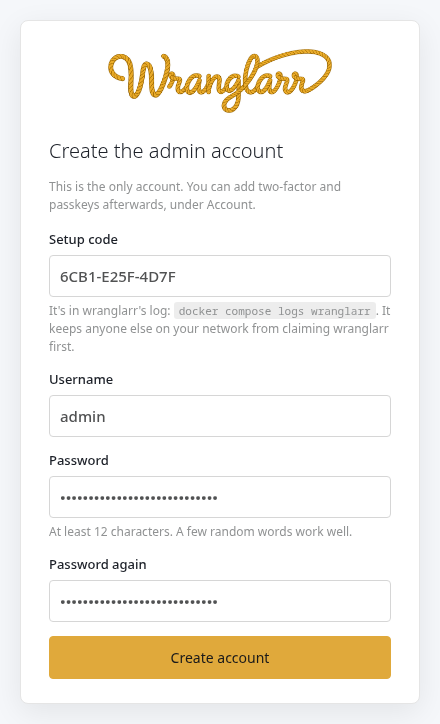
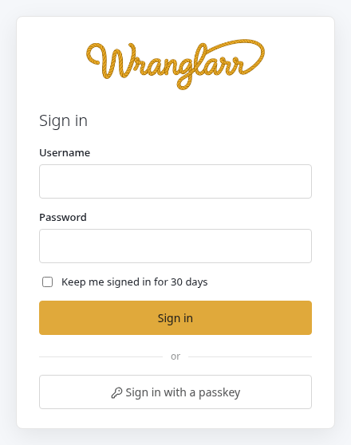
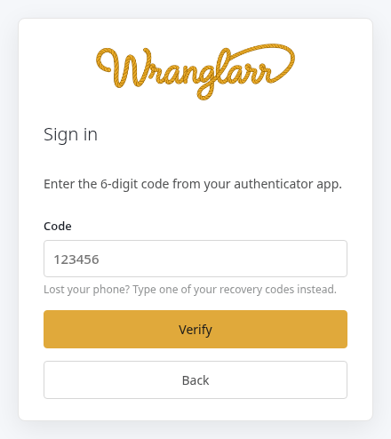
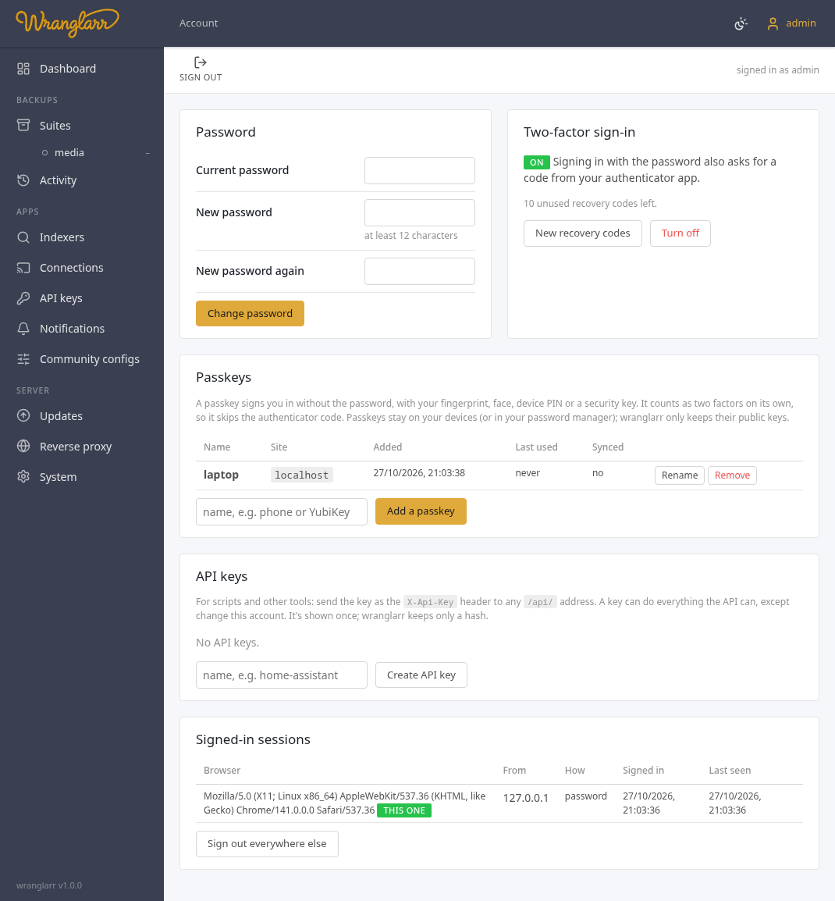
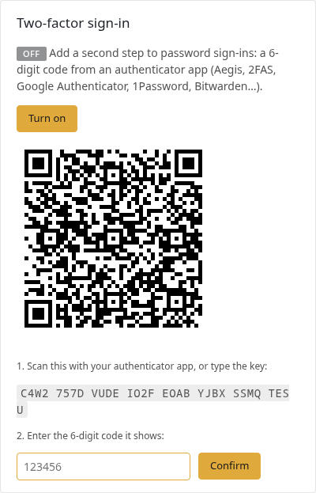
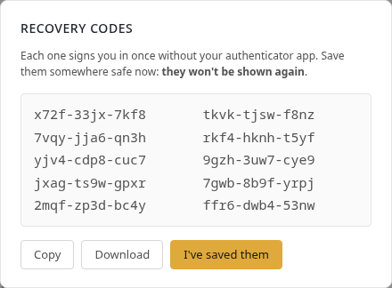
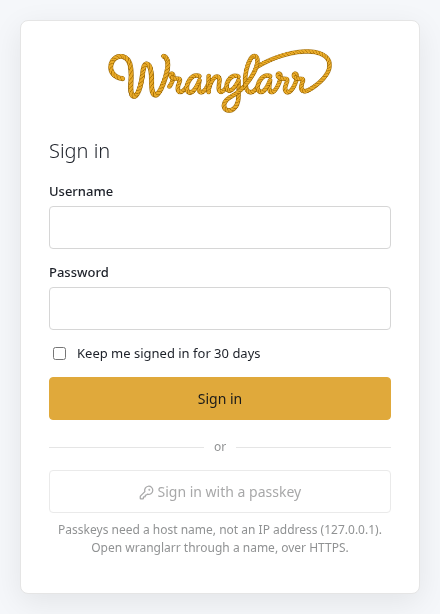

# Login

wranglarr has its own login, built in. You don't need an identity provider,
LDAP or a reverse proxy for it:

- a **username and password** (the account you create on the first visit);
- optional **two-factor**: a 6-digit code from an authenticator app (TOTP), with recovery codes;
- **passkeys**: sign in with your fingerprint, face, device PIN or a security key instead of the password.

Every page and every `/api/` address needs a sign-in. Scripts use an
[API key](#api-keys).

There is one account, the admin. Code: `src/auth/` and `src/web/auth.rs`.

## First visit

The first time you open wranglarr it asks you to create the account:



- **Setup code.** Until the account exists, anyone who reaches wranglarr's port could create it. So it also asks for a one-time code, which only someone who can read wranglarr's log has:

  ```sh
  docker compose logs wranglarr
  ```

  It's in an amber box: `wranglarr has no account yet … XXXX-XXXX-XXXX`. The code changes each time wranglarr starts, until the account exists. If the page was open from before a restart, its code is stale: wranglarr says so and prints a new one in the log.
- **Password:** at least 12 characters, not a common password, and not containing the username. A few random words make a good one.

You're signed in straight away and land on **Account**. Turn on two-factor or
add a passkey there.

## Serving wranglarr under a path

Set `WRANGLARR_URL_BASE=/wranglarr` to use a browser address such as
`https://myhouse.com/wranglarr`. Sign-in pages, redirects and the Account page
use that prefix. With AuthTunnel, `AUTH_LOGIN_URL` must include it too.
Cookies remain `Path=/` so sibling app paths can share the session.

Changing only the path on the same hostname does not change a passkey's RP ID;
there is no need to register the passkey again. See the
[proxy setup instructions](Reverse-Proxy.md#wranglarr-at-a-path-on-the-domain).

## Signing in



- **Keep me signed in for 30 days** keeps the session for 30 days. Without it, the session ends when the browser closes, and after 24 hours at most.
- **With two-factor on**, a correct password is followed by the code step. A recovery code works in the same box.

  
- **Sign in with a passkey** appears once you've added one. It skips both the password and the code. A passkey already proves two things: the device it's on, and your fingerprint, face or PIN on it.

**Lockout:** five failed sign-ins from one address within 15 minutes lock
that address out for 15 minutes. Wrong codes count too, including wrong setup
codes. Lockouts are kept in memory only, so restarting wranglarr clears them:
`docker compose restart wranglarr`.

## Account page

Sidebar → **Account**, or the 👤 in the header.



| Section | |
| --- | --- |
| Password | change it (needs the current one) |
| Two-factor sign-in | turn TOTP on or off, make new recovery codes |
| Passkeys | add, rename, remove |
| API keys | create, revoke |
| Signed-in sessions | every browser that's signed in: where from, how, when. Sign out one, or all the others |

Adding a passkey, turning two-factor on or off, new recovery codes and new
API keys all ask for your password again. Someone who borrowed a signed-in
browser can't lock you out or keep access.

## Two-factor (TOTP)

**Turn on** shows a QR code and the same key as text:



Scan it with any authenticator app, such as:

- Aegis, 2FAS or Google Authenticator;
- Microsoft Authenticator;
- 1Password, Bitwarden or KeePassXC.

Type the code it shows to confirm. wranglarr then shows **ten recovery
codes**, once:



Each one signs you in once in place of the app code. Save them in your
password manager, or download and print them. **New recovery codes** replaces
the whole set.

How codes are checked:

- one 30-second step of clock drift is allowed either way;
- a code that has already been used is refused, even within its 30 seconds.

## Passkeys

A passkey is a key pair made by your device: a phone, laptop, password
manager or security key.

- wranglarr keeps only the public key.
- Signing in proves you hold the private key, after your fingerprint, face or PIN unlocks it.
- It can't be phished: the browser only offers it to the site it was made for.

**Add one:** Account → Passkeys → name it (`phone`, `YubiKey`) → **Add a
passkey** → your password → follow the browser's prompt.

- Add more than one, for example your phone and a security key, so losing one device doesn't lock you out of the passkey route. The password still works anyway.
- **Synced: yes** means the passkey is backed up by its provider (iCloud Keychain, Google Password Manager, 1Password, Bitwarden) and is on your other devices too.

### Passkeys need HTTPS and a host name

This is a browser rule, not wranglarr's. Passkeys only work on:

- **an HTTPS address with a valid certificate on a host name**, for example `https://wranglarr.home.example.com`; or
- **`http://localhost`**, on the machine running wranglarr.

At `http://192.168.1.10:8787` the passkey button stays greyed out and says why:



Password and two-factor work everywhere.

To get HTTPS, put wranglarr behind:

- **a reverse proxy with a certificate**: Caddy, Traefik, Nginx Proxy Manager or SWAG, with a name in your own domain. Let's Encrypt's DNS challenge works for names that only resolve at home.
- **Tailscale:** `tailscale serve --bg 8787` on the host gives wranglarr `https://<machine>.<tailnet>.ts.net` with a real certificate, reachable from your devices only.

A passkey belongs to the host name it was made on (the **Site** column). If
you reach wranglarr under two names, add a passkey on each.

**Behind a reverse proxy**, pass the original host name and scheme on. That's
the default in Caddy and Traefik. In Nginx:

```nginx
proxy_set_header Host $host;
proxy_set_header X-Forwarded-Proto $scheme;
```

Set `FORWARDED_ALLOW_IPS` in `.env` to the comma-separated **exact IP addresses
of the proxies connecting to wranglarr**, then recreate the container with
`docker compose up -d wranglarr`. The default trusts only `127.0.0.1`;
Docker and remote proxies usually connect from another address. An empty value
trusts none. Forwarded host, scheme and client IP are ignored from other peers.
Without proxy trust, HTTPS pages may show passkeys as unavailable, cookies
will lack `Secure`, and a rewritten `Host` can cause browser changes to be refused.

The proxy must replace incoming `X-Forwarded-Host` and `X-Forwarded-Proto` with
the original browser host and scheme. Restrict access to wranglarr's port so
that a trusted address cannot also carry direct, unfiltered client requests
(Docker port forwarding can make them share a source IP). `*` trusts every
known peer; use it only when the port is reachable exclusively by your proxy.

wranglarr uses them to:
- check that requests come from its own pages;
- match passkeys to the right site;
- mark the session cookie `Secure`.

## API keys

For scripts, Home Assistant, monitoring and so on.

- **Create:** Account → API keys → name → **Create API key**. The key starts with `wr_`, is shown once, and only its hash is stored.
- **Use:** send it as a header to any `/api/` address:

```sh
curl -H "X-Api-Key: wr_…" http://wranglarr:8787/api/suites
curl -X POST -H "X-Api-Key: wr_…" http://wranglarr:8787/api/suites/media/backup
```

A key can do everything the [HTTP API](API.md) can. It
can't change the account itself (password, two-factor, passkeys, keys,
sessions). **Revoke** stops a key at once.

`GET /api/health` answers without a sign-in, but then only says
`{"ok": true}`, for uptime checks. With a key or a session it adds the
details.

## Locked out

From a shell on the host, `wranglarr-auth` changes the account directly:

```sh
docker compose exec wranglarr wranglarr-auth status            # account, two-factor, passkeys, sessions, keys
docker compose exec -it wranglarr wranglarr-auth set-password  # asks for a new one
docker compose exec wranglarr wranglarr-auth disable-2fa       # lost your phone and the recovery codes
docker compose exec wranglarr wranglarr-auth remove-passkeys
docker compose exec wranglarr wranglarr-auth sign-out-all
docker compose exec -it wranglarr wranglarr-auth reset         # delete the account; the next visit sets it up again
```

After `reset`, open wranglarr: a new setup code is in the log.

Locked out by too many failed sign-ins? `docker compose restart wranglarr`
clears the lockout.

Only someone who can run commands in the container can do this, which
already means control of the host.

## How it's protected

| | |
| --- | --- |
| Passwords | scrypt (N=2¹⁵, r=8, p=1) with a random salt |
| Sessions | a random 256-bit token in a cookie that scripts can't read (`HttpOnly`), that other sites can't make the browser send (`SameSite=Strict`), and that is `Secure` over HTTPS. Only its SHA-256 is stored. |
| AuthTunnel | with `APPS_AUTH=tunnel` the same cookie lets you into the apps through wranglarr-gate. It is then `SameSite=Lax`, so a link to an app from another page works, and with `AUTH_COOKIE_DOMAIN` it's set for that domain, so it reaches `radarr.example.com` and the rest. After signing in, wranglarr sends you back only to an address that cookie reaches. See [App logins](App-Logins.md). |
| Forged requests (CSRF) | any request that changes something, made with a session cookie, must come from one of wranglarr's own pages, checked by its `Origin` header. API-key requests don't need it. |
| Passkeys | WebAuthn through [py_webauthn](https://github.com/duo-labs/py_webauthn), user verification required, discoverable credentials. Each is bound to its host name. |
| Two-factor | RFC 6238 TOTP (SHA-1, 6 digits, 30 s) with replay protection; recovery codes stored hashed |
| Guessing | lockout per address; wrong usernames take as long to refuse as wrong passwords |
| Where it's kept | `appdata/wranglarr/wranglarr.db`: kv `auth:account`, `auth:api_keys`, and the `sessions` table |

## Turning the login off

`WRANGLARR_AUTH=off` in `.env`, then `docker compose up -d wranglarr`. Do
this only if wranglarr sits behind a reverse proxy that asks for a login
itself (Authelia, Authentik, a proxy's own basic auth). With it off, anyone
who reaches the port has full control.

wranglarr then prints an amber warning in its log at every start, and the
System page shows **Login: off** in red.

With AuthTunnel (`APPS_AUTH=tunnel`) this would open every app as well, so
`init.sh` refuses the combination.
