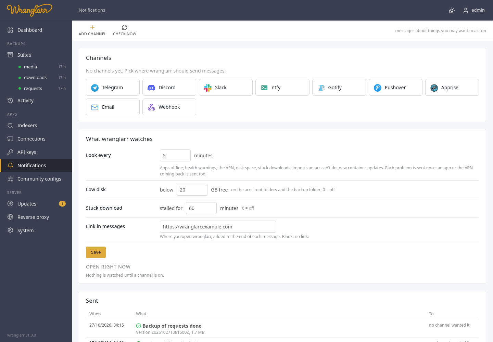

# Notifications

**Notifications** in the sidebar sends you a message when something in the
stack needs you: a backup failed, an app went offline, a download is stuck,
an arr can't import something, the disk is filling up. It works with
Telegram, Discord, Slack, ntfy, Gotify, Pushover, Apprise (which reaches 100+
more services), email and a plain webhook.



## Adding a channel

1. **Add channel** in the toolbar, pick the service, fill in its fields. Each field says
   where to find the value (a Telegram bot token from @BotFather, a Discord
   webhook from the channel's Integrations settings, …).
2. **Send a test**. You get "wranglarr: test" on that service, or the error
   the service returned (with your token taken out of it).
3. Tick the events you want under **Send me** (**the usual** picks the defaults below) and **Save**.

| Service | What it needs |
| --- | --- |
| Telegram | bot token, chat ID (yours, or a group's starting with `-100`), optional topic ID |
| Discord | a channel webhook URL |
| Slack | an incoming-webhook URL |
| ntfy | server (default `https://ntfy.sh`), topic, optional access token or user / password. On ntfy.sh anyone who knows the topic can read it: pick one that's hard to guess |
| Gotify | server and an app token |
| Pushover | user key and an app token |
| Apprise | an [Apprise API](https://github.com/caronc/apprise-api) server, and a saved config key or the Apprise URLs themselves |
| Email | SMTP server, port, STARTTLS / TLS / none, optional login (Gmail and others want an app password), From, To (comma separated) |
| Webhook | a URL; wranglarr POSTs `{"event", "level", "title", "message", "at"}` as JSON. Optional basic auth |

Passwords and tokens are never sent back to the browser: the form shows
`••••••••`, and saving with that left in place keeps the stored value.

## What wranglarr tells you about

| Event | On for a new channel | Sent when |
| --- | --- | --- |
| A backup failed or is incomplete | yes | a backup job ends failed or partial |
| A backup finished | no | a backup succeeds |
| A restore finished or failed | yes | any restore ends |
| Container updates are available | yes | the update check finds new images (held containers left out) |
| Containers were updated | no | an update or rollback succeeds |
| A container update failed or was reverted | yes | an update fails, or the old container was put back |
| A newer wranglarr is out | yes | the update check finds a newer image for wranglarr's own container; once per new image, with the [release notes](Release-Notes.md) and either **Update now** or the shell command ([Keeping wranglarr itself up to date](Updates.md#keeping-wranglarr-itself-up-to-date)) |
| Connecting apps, shared settings or indexers failed | yes | one of those jobs ends failed or partial |
| An app's API key changed and wranglarr reconnected the apps using it | yes | a key changed in an app and another app had to be reconnected ([API keys](Live-Status.md#a-key-changed-in-an-app)) |
| An app went offline (and came back) | yes | an app doesn't answer two checks in a row; again when it's back |
| An app has a new health warning | yes | a warning or error appears in an app's own System → Status |
| The VPN is down (and back up) | yes | gluetun isn't running, two checks in a row; again when it's back |
| Disk space is low | yes | a root folder of an arr, or the backup folder, has less free than the limit |
| A download is stalled or in error | yes | a download client reports an error, or a download has been stalled or waiting for metadata longer than the limit |
| An arr can't import a download and needs you | yes | an item in an arr's queue is blocked, failed or waits for a manual import |
| Someone was locked out of wranglarr after failed sign-ins | yes | the sign-in lockout triggers ([Login](Login.md)) |

Job events go out as soon as the job ends. The rest come from a watcher that
looks at the stack every few minutes. It remembers what it has sent, so each
problem arrives once, not every round. Several new problems of one kind in
the same round come as one message ("3 new health warnings"). An app's
health warnings and queue items aren't sent again because the app was
offline for a while.

The watcher only runs while at least one channel is on.

## What wranglarr watches

| Setting | Default | |
| --- | --- | --- |
| Look every | 5 minutes | how often the watcher looks |
| Low disk | below 20 GB free | the limit for the arrs' root folders and the backup folder; 0 turns the check off |
| Stuck download | stalled for 60 minutes | how long a download may be stalled before you hear about it; 0 turns it off |
| Link in messages | blank | an address added to every message, e.g. `https://wranglarr.example.com` |

**Open right now** lists what the watcher is tracking at the moment and
whether it has been sent. **Check now** in the toolbar runs a round straight away.
**Sent** is the log of the last 100 messages and how each channel answered.

## The arrs' own notifications

A channel can also be added to Radarr's, Sonarr's, Lidarr's and Prowlarr's
own **Settings → Connect**, so the arrs send their grabs, imports, upgrades,
failed imports and health issues to the same place. Pick the arrs and the
events under **Also in the arrs**. wranglarr creates one entry called
`wranglarr · <channel name>` in each, using that arr's own fields for the
service, and the arr tests it before saving.

Changing the channel updates those entries; un-picking an arr, or deleting
the channel, removes it again. Entries you made yourself in the arrs are
never touched.

## HTTP API

```
GET    /api/notify                    services, events, channels (secrets masked), settings, open problems, log
POST   /api/notify/channels           {"kind":"telegram","name":"…","enabled":true,"config":{…},"events":[…],"arr":{"apps":[…],"events":[…]}}
PUT    /api/notify/channels/{id}      same body; "••••••••" keeps a stored secret
DELETE /api/notify/channels/{id}      also removes it from the arrs
POST   /api/notify/test               {"channel":{…},"id":"…"}  -> {"ok":true} or {"ok":false,"error":"…"}
PUT    /api/notify/settings           {"interval":5,"disk_free_gb":20,"stall_minutes":60,"link":""}
POST   /api/notify/check              one watcher round now
```

The save and delete answers include `arrs`: what was done in each arr
(`created`, `updated`, `removed`, `none`, or an error).
