# Quickstart

This walks through a first install from an empty folder to a working,
backed-up stack. Every screenshot is from a real install. By the end you have:

- Radarr, Sonarr, Lidarr, Prowlarr and Bazarr on Postgres
- qBittorrent and SABnzbd saving into the same `/data` folder the arrs import from
- every download client added to every arr, the arrs added to Prowlarr and Bazarr, all without typing a host name or API key
- nightly backups that still work if wranglarr is gone

It takes about 15 minutes, most of it waiting for images to download. The
reference pages are [Setup](Setup.md) and
[Environment Variables](Environment-Variables.md); this page is the guided
route through them.

**You need:**

- Docker with the compose plugin, or Podman with `podman compose` and its API socket turned on (`systemctl --user enable --now podman.socket`; wranglarr uses it for restores and updates).
- A drive or folder for downloads and media, for example `/mnt/data`. Downloads and media must be on the **same** filesystem so imports can hardlink instead of copying.
- Bash 4 or newer for `init.sh`: any Linux, WSL on Windows, or macOS with `brew install bash` (macOS ships Bash 3.2).

On **TrueNAS SCALE**, [TrueNAS SCALE](TrueNAS.md) covers the datasets and permissions first, then follows these steps with `sudo`.

## 1. Get the stack

```sh
git clone https://github.com/Wranglarrr/Wranglarr arrs && cd arrs
```

wranglarr's image holds both the setup wizard and wranglarr itself; the
commands below pull the published one. To build it yourself, see
[The wranglarr image](Setup.md#the-wranglarr-image). Podman users: replace
`docker` with `podman` here and below.

## 2. Run the setup wizard

The wizard writes your `.env`. It runs from wranglarr's image, so it needs
nothing else installed:

```sh
docker run --rm -it -p 8788:8788 \
  -v "$PWD":/stack \
  -v /mnt/data:/data \
  ghcr.io/wranglarrr/wranglarr:latest wranglarr-setup
```

Mount your data drive as `/data` so the wizard can check it. It prints a
link like **http://localhost:8788/?t=Xy3kQ9pL2aM**: open that one. The code
in it keeps other people on your network out of the wizard while it runs.
From another computer, put the server's address in place of `localhost`.

> Rootless Podman: add `--userns=keep-id`. Otherwise the wizard sees your files as owned by root and reports them as not writable.

### Services

Tick what you want. Postgres and wranglarr always run. Prowlarr is worth
ticking: you add trackers to it once and it hands them to every arr.

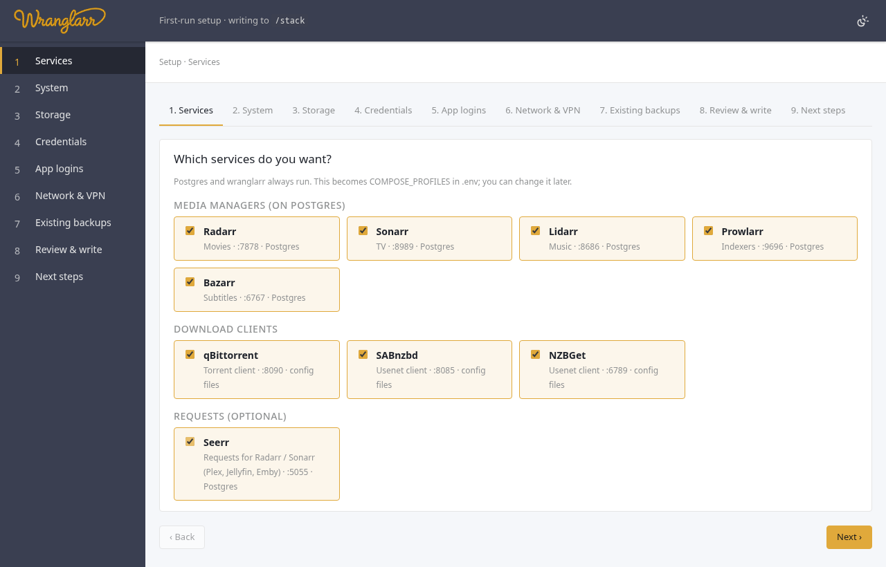

### System

The timezone and the user the containers run as. On Linux, `id` prints your
PUID and PGID. They should own your data drive; the next step shows you who
does.

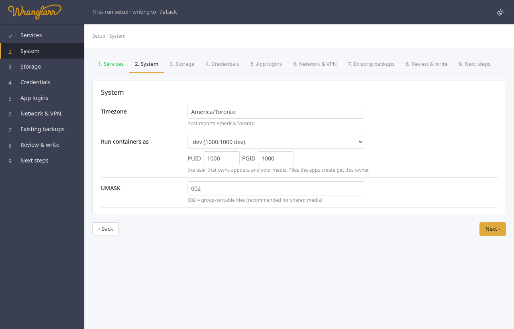

### Storage

Type **host** paths. They go into `.env` exactly as typed. Each one is checked
through its mount: owner, permissions, whether PUID/PGID can write it, and
free space. Green means it's fine.

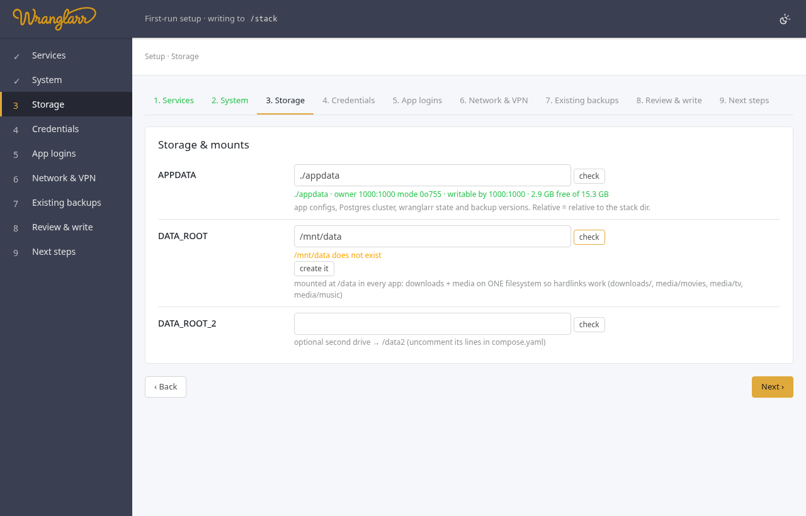

### Credentials

The Postgres password and gluetun key are generated for you. The backup
schedule is when the media suite (the arrs) backs up; the download clients
and Seerr keep their own times (04:00 and 04:15), and a blank schedule turns
automatic backups off for all of them. Retention applies to every suite. You
can change both in wranglarr later.

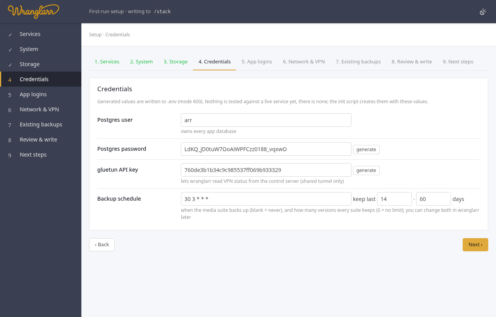

### App logins

How you sign in to the apps themselves (wranglarr has its own login either
way):

- **One login for every app** (the default): init sets the same username and
  password in each app. Generate the password; better not your wranglarr one.
- **AuthTunnel**: the apps get no login of their own, and you sign in once, to
  wranglarr. If you'll reach the apps through a reverse proxy at names like
  `radarr.example.com`, say so and give the domain.
- **Leave them to me**: each app asks you on first visit, as without wranglarr.

[App logins](App-Logins.md) has the details. You can change it later without
redoing the rest.

### Network and VPN

The ports published on the host, and whether to route the apps through a VPN.
"One shared tunnel" puts the apps behind a single WireGuard or OpenVPN
connection; **In the tunnel** says which: every app (the simplest), the
download clients and Prowlarr, or the download clients only (see [VPN: Shared
Tunnel](VPN-Shared-Tunnel.md#which-apps-go-in-the-tunnel)). If you pick it,
this step asks for the provider and keys.

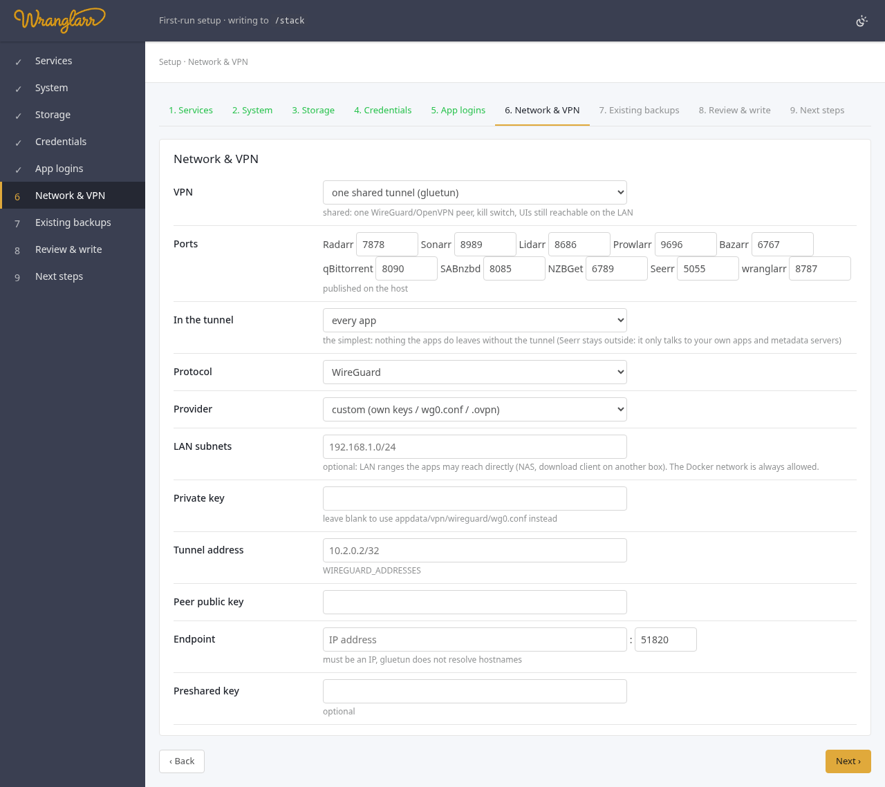

### Existing backups

On a brand-new install this step is empty. If your `appdata/backups` already
holds wranglarr versions, from another machine or before a reinstall, tick
the apps to bring back. wranglarr then offers a one-click restore once
everything is running.

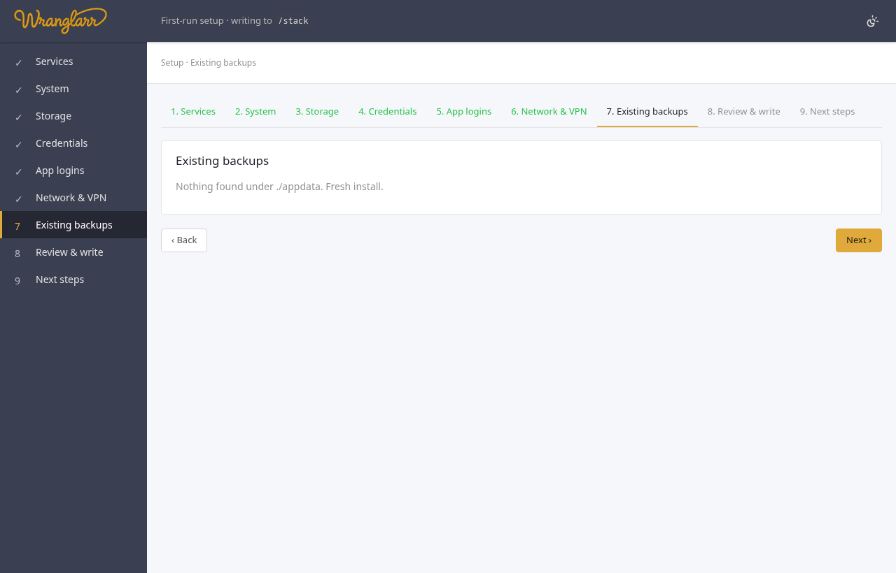

### Review and write

The `.env` that will be written, with secrets masked. **Write files** saves
it with mode 600. An existing `.env` is kept as `.env.bak-<time>`.

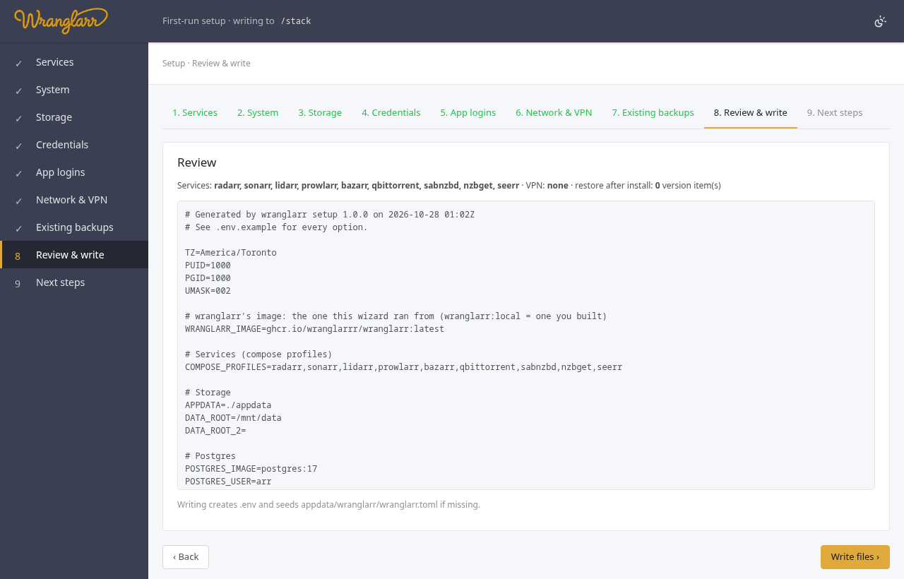

### Next steps

The wizard lists what's left for your choices. Stop it with Ctrl-C.

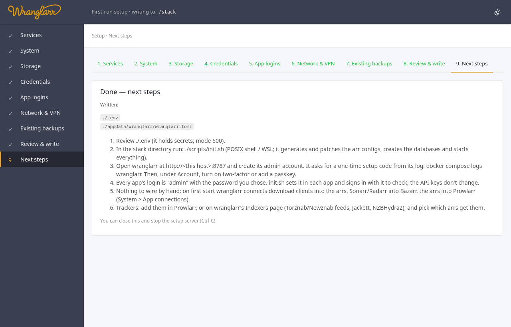

## 3. Run `init.sh`

```sh
./scripts/init.sh
```

On first run it:

1. Starts each arr once without Postgres so it writes its own `config.xml` (API key, port), then stops it.
2. Points each `config.xml` at Postgres. Postgres creates one database per app on its first start.
3. Starts each download client once to generate its default config, then points its save folders at the shared mount: qBittorrent at `/data/torrents`, SABnzbd at `/data/usenet/incomplete` and `/data/usenet/complete`. It also adds `sabnzbd` to SAB's host whitelist and turns on SAB's NZB copies, so backups can bring queued jobs back.
4. Creates the download folders, one per arr and Prowlarr (`/data/torrents/radarr`, `/data/usenet/complete/sonarr`, …).
5. Writes qBittorrent's login into its config, if you picked one login for every app or AuthTunnel.
6. Starts the whole stack.
7. Sets the apps' logins the way you picked, and signs in to each one to check (AuthTunnel: starts wranglarr-gate in front of them).

The end of a successful run looks like this:

```
init: patching configs (Postgres: radarr sonarr lidarr prowlarr; download paths: qbittorrent sabnzbd)
[radarr] patched: +PostgresHost +PostgresPort +PostgresUser +PostgresPassword +PostgresMainDb +PostgresLogDb
...
patch_downloads: sabnzbd: download_dir: Downloads/incomplete -> /data/usenet/incomplete; complete_dir: Downloads/complete -> /data/usenet/complete; ...
init: starting the full stack (profiles: radarr,sonarr,lidarr,prowlarr,bazarr,qbittorrent,sabnzbd)

Done.  wranglarr: http://localhost:8787
```

Running it again later is safe. Apps that are already set up are not
regenerated, the Postgres settings are re-applied, and download folders are
only changed while they are still at the clients' defaults. To change the
Postgres password, follow [Changing the Postgres password](Setup.md#changing-the-postgres-password):
editing `.env` alone isn't enough.

## 4. Logins you set yourself ("leave them to me" only)

With one login for every app, or AuthTunnel, init did this: skip to
[5. Open wranglarr](#5-open-wranglarr).

### qBittorrent's password

qBittorrent starts with a temporary admin password and prints it in its log:

```sh
docker compose logs qbittorrent | grep -i password
```

Log in at http://localhost:8090 and set a permanent password under
Options → Web UI. Put it in `.env`, then restart wranglarr so it can log in
and add qBittorrent to the arrs:

```sh
# .env
QBITTORRENT_USER=admin
QBITTORRENT_PASSWORD=your-new-password
```

```sh
docker compose up -d wranglarr
```

### The arrs' login prompt

The first time you open Radarr, Sonarr, Lidarr or Prowlarr, it insists on a
login. Pick **Forms (Login Page)**. Setting "Authentication Required" to
*Disabled for Local Addresses* keeps your own network password-free.

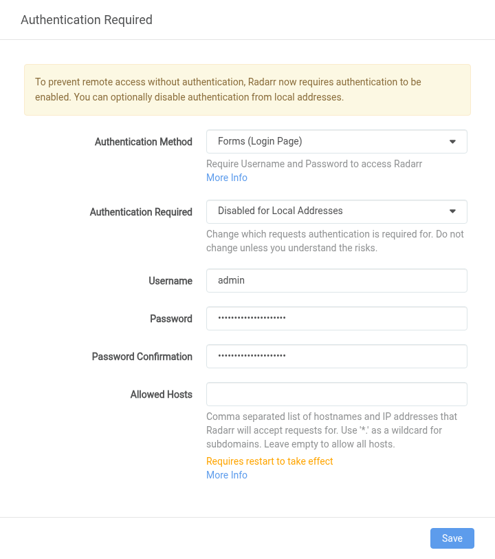

**Leave Allowed Hosts empty.** If you fill it, include the app's container
name as well, for example `radarr` or `127.0.0.1,radarr`. Otherwise the app
refuses every request addressed to `radarr:7878`: wranglarr, Prowlarr, Bazarr
and the other arrs all get "400 Bad Request". wranglarr's error then names
this setting. The fix is in [Troubleshooting](Troubleshooting.md).

## 5. Open wranglarr

**http://localhost:8787**. The first visit asks you to create wranglarr's
admin account:


The **setup code** is in wranglarr's log, in an amber box. It makes sure the
person creating the account is someone who can read the log:

```sh
docker compose logs wranglarr
```

Pick a password of at least 12 characters. You land on **Account**, where you
can turn on two-factor (an authenticator app) or add a passkey. Passkeys need
HTTPS on a host name; see [Login](Login.md).

Then click **Dashboard** in the sidebar: a poster per app with its stats
underneath. Click a poster to open that app ([Dashboard](Dashboard.md)).

**Suites** shows each suite: every app's version, database, collection
size and health, plus the latest backups.

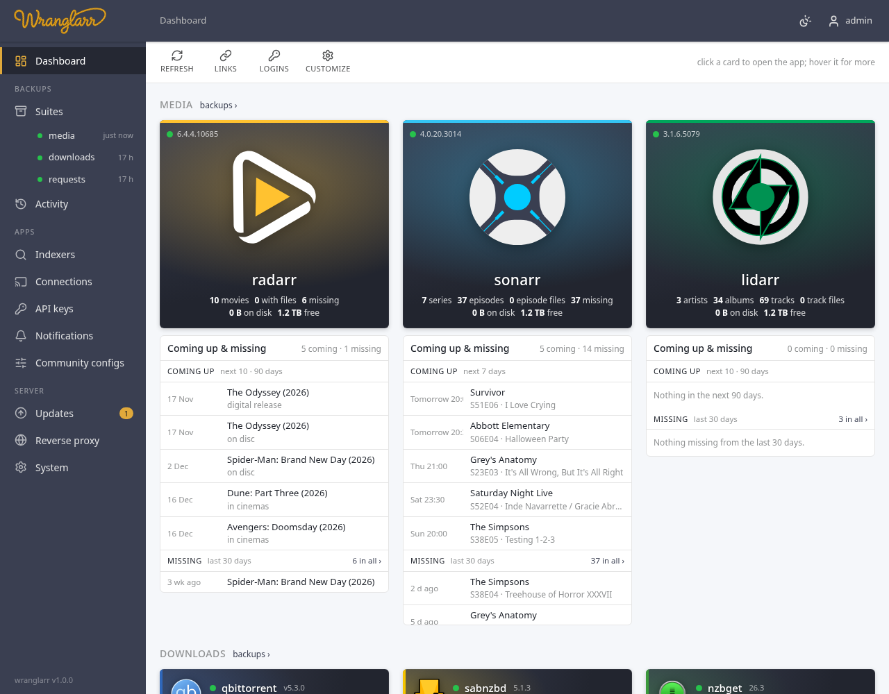

The screenshot is from after the steps below. On a brand-new install the
cards also show the apps' own health warnings in orange, so you don't have to
open each app: they say what's still missing (no indexers yet, no root
folder). The next steps clear them.

## 6. Check the app connections

On its first start wranglarr connects everything that can talk to everything
else. The result is under **System → App connections**, drawn as a map: an
arrow from each app to the one it reaches, with heads at both ends (in blue)
where the two reach each other. **List** switches to a table.

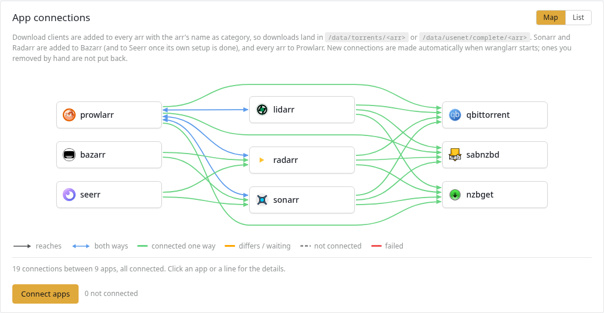

- **Every download client into every arr.** Each arr's category is its own name, so finished downloads land in `/data/torrents/radarr`, `/data/usenet/complete/sonarr` and so on. That's the same path the arr sees, so no remote path mapping is needed.
- **Sonarr and Radarr into Bazarr.**
- **Every arr into Prowlarr**, so trackers you add there reach all of them.

A connection that fails, for example qBittorrent before you've set its
password, is tried again the next time wranglarr starts. You can also press
**Connect apps**. wranglarr never re-adds a connection you deleted by hand.

Here is the result inside Radarr (Settings → Download Clients):

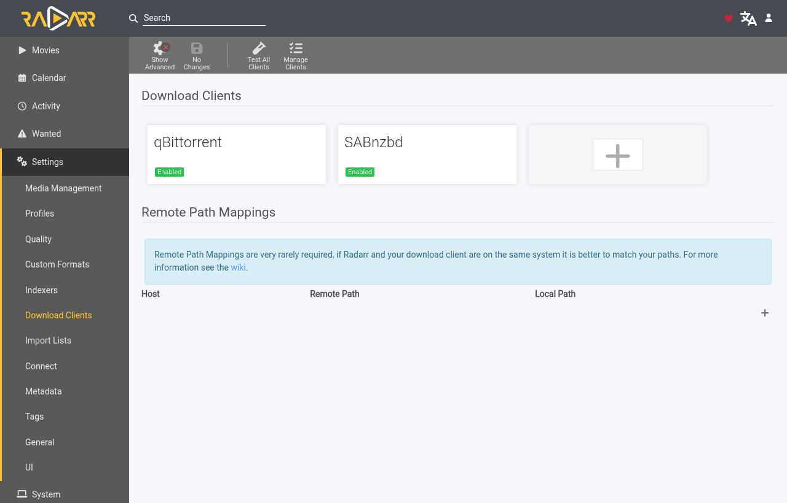

And inside Bazarr (Settings → Sonarr):

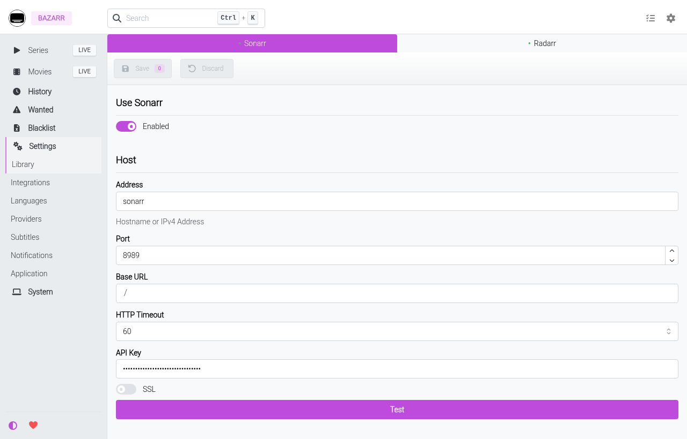

## 7. Add trackers

wranglarr's **Indexers** page shows both ways to do it.

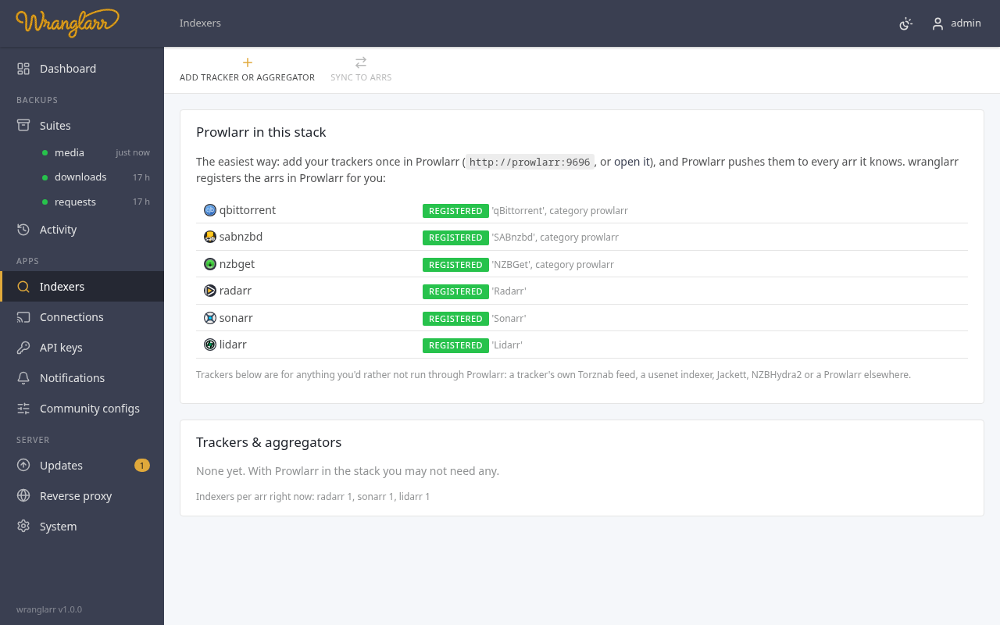

**With Prowlarr (recommended).** Open Prowlarr (http://localhost:9696), go to
Indexers → Add Indexer and add your trackers. Prowlarr pushes them to Radarr,
Sonarr and Lidarr on its own; the top panel shows they are registered.

**Directly from wranglarr.** For a tracker's own Torznab feed, a usenet
indexer, Jackett, NZBHydra2 or a Prowlarr on another machine, press
**Add tracker or aggregator**. Choose which arrs get it under **Push to**:

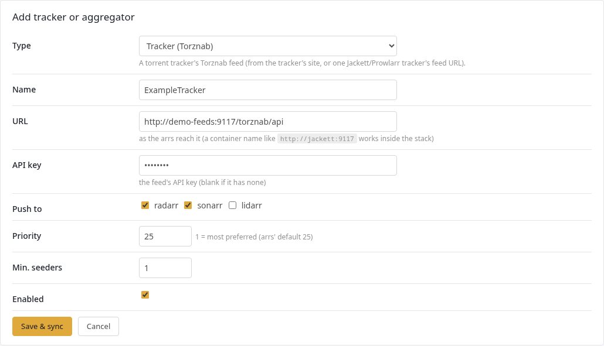

**Save & sync** adds it to the arrs you picked. Each arr tests the feed
before saving, and the run log shows what happened:

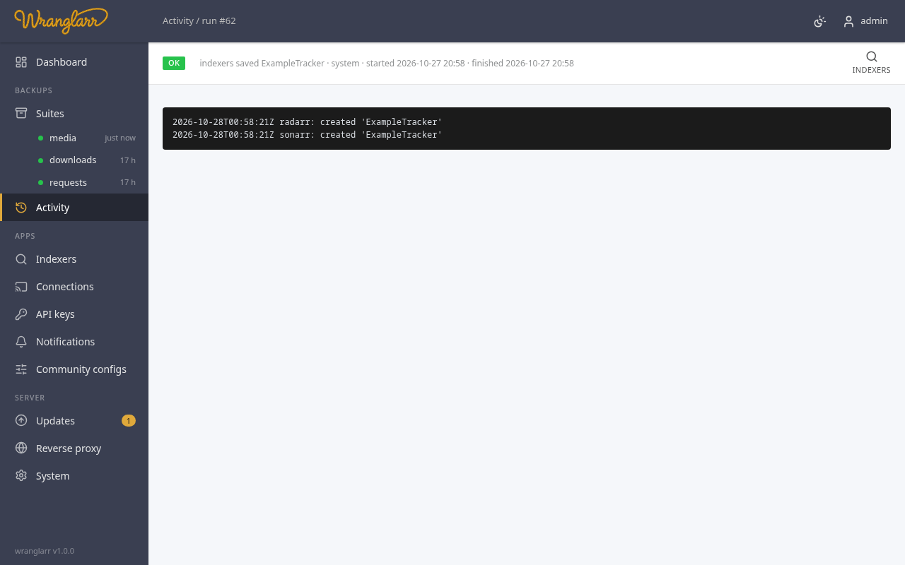

The table shows which arr has which source:

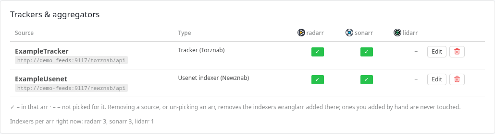

Unticking an arr, or deleting a source, removes what wranglarr added. Indexers
you added in an arr by hand are never touched. Jackett is expanded: every
tracker configured in it becomes its own indexer, "Tracker (Jackett)". More
in [Indexers](Indexers.md).

## 8. Finish inside the apps

wranglarr wires the apps together but doesn't choose your library. In each
app:

- **Radarr / Sonarr / Lidarr** → Settings → Media Management → Root Folders: `/data/media/movies`, `/data/media/tv`, `/data/media/music`. They're on the same `/data` mount as the downloads, so imports are instant hardlinks.
- **Bazarr** → Settings → Languages: create a language profile and set it as the default for series and movies. Then add subtitle providers under Settings → Providers.
- Quality profiles, custom formats and so on are up to you.

## 9. Take your first backup

Open a suite (sidebar → **media**) and press **Backup now**. The suite page
also holds its schedule and retention:

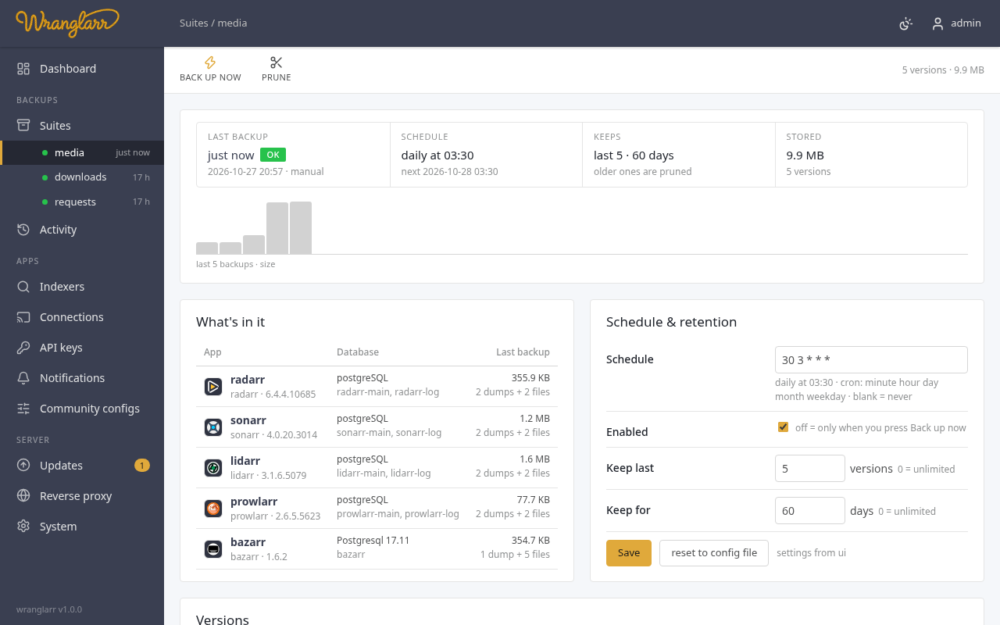

The run log shows each step. For each app: database dumps, the app's own
backup zip, and a plain copy of its `/config`:

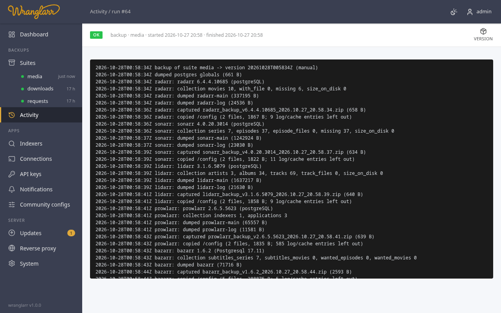

Each version page lists what it holds. It has **Restore** buttons per app:
databases only, config only, or both.

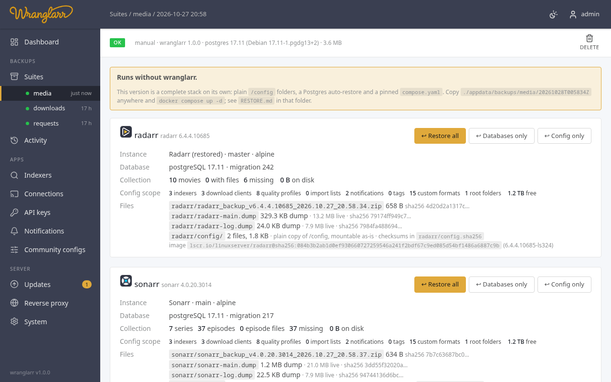

The yellow banner matters: **a version runs without wranglarr**. Every folder
under `appdata/backups/<suite>/<version>/` has a `compose.yaml` pinned to the
exact images that were running, and a Postgres script that restores the dumps
on first start. If wranglarr ever disappears, copy the folder and run
`docker compose up -d` in it. See
[Backups and Restore](Backups-and-Restore.md#without-wranglarr).

The **downloads** suite backs up the torrents and NZBs themselves (`.torrent`
files with resume data, SAB's queue and NZB copies), not the downloaded files:

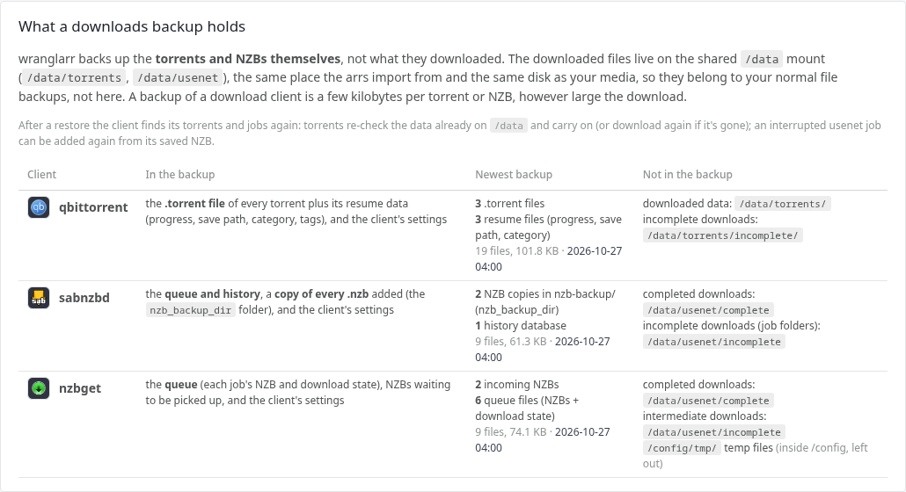

The downloaded files live on `/data` next to your media. They belong in your
normal file backups.

## 10. Keep it updated

**Updates** checks every container's image against its registry every six
hours. **Update** backs up the affected suite, pulls the new image and
recreates the container with the same settings. If the new container doesn't
come up healthy, wranglarr puts the old one back. **Roll back** goes to the
previous image and holds it there.

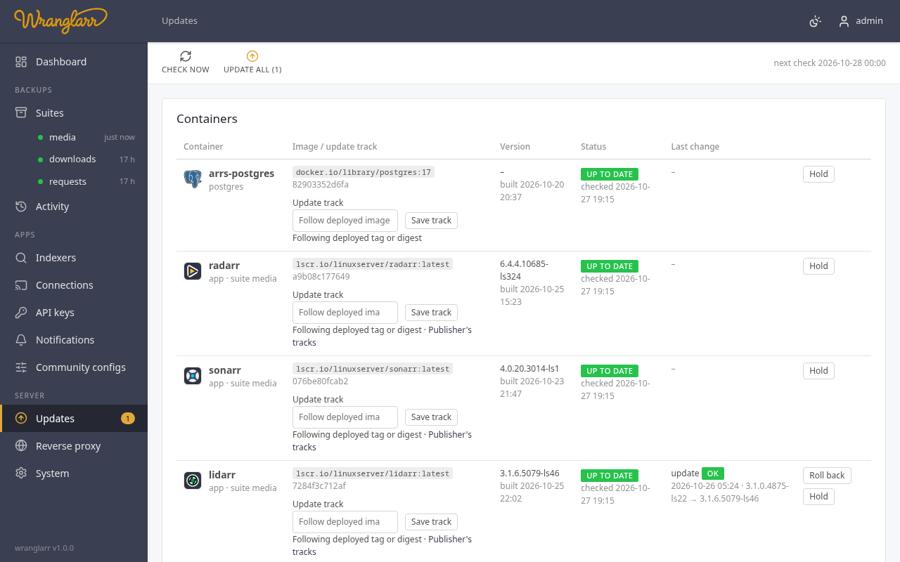

Automatic updates are off by default. Turn them on, and set when they run,
under **Automation** further down the page. Details in [Container Updates](Updates.md).

## Where next

- [App Connections](App-Connections.md): exactly what gets wired, and how the VPN changes the addresses
- [Indexers](Indexers.md): every source type, and how removal works
- [VPN: Shared Tunnel](VPN-Shared-Tunnel.md): route the apps through WireGuard
- [Remote access](Remote-Access.md): reach the stack from outside with Tailscale or Cloudflare
- [Troubleshooting](Troubleshooting.md): the known gotchas, each with its fix
