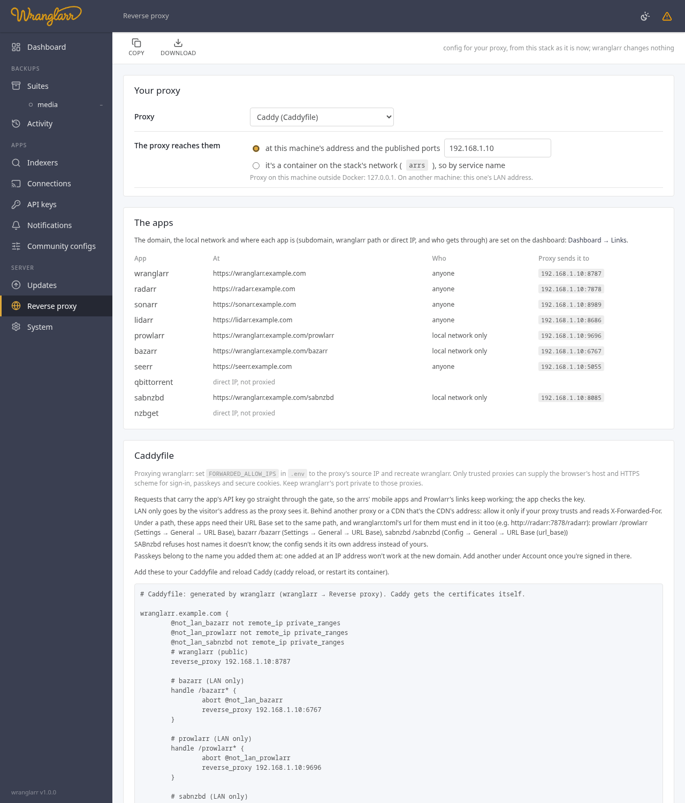

# Reverse proxy

To reach the stack from outside your network, or by name instead of
`IP:port`, put a reverse proxy in front of it (or use Tailscale: see
[Remote access](Remote-Access.md)). wranglarr writes the config for
you: **Reverse proxy** in the sidebar. It changes nothing itself. You paste the
result into your proxy.



## Choices

| Setting | |
| --- | --- |
| **Proxy** | Caddy, nginx, Traefik (file provider or Docker labels), caddy-docker-proxy (Docker labels), Cloudflare Tunnel, Nginx Proxy Manager |
| **The proxy reaches them** | at this machine's address and the published ports (the proxy runs on the host, or on another machine), or by service name (the proxy is a container on the stack's `arrs` network) |

The domain, the local network, and where each app is are set on the dashboard,
under **Links** ([Dashboard](Dashboard.md#where-the-apps-open)), so the cards
and the config agree. Per app, and for wranglarr itself:

| | |
| --- | --- |
| **Subdomain** | its own name, `https://radarr.example.com` |
| **Path on the domain** (wranglarr) | `https://myhouse.com/wranglarr`, with `WRANGLARR_URL_BASE=/wranglarr` |
| **wranglarr path** | under wranglarr's name, `https://wranglarr.example.com/radarr` |
| **Direct IP** | not proxied: only `http://<this machine>:<port>` |
| **local only** | proxied, but only for addresses on your local network (an IP allowlist in the proxy) |

This page lists them, with where the proxy sends each.

When proxying wranglarr, set `FORWARDED_ALLOW_IPS` in `.env` to the proxy's exact
source IP as seen by wranglarr, then recreate its container. It defaults to
`127.0.0.1`; Docker and remote proxies usually need another address. The proxy
must replace forwarded host and scheme headers, and wranglarr's port must be
private to those proxies. These settings let wranglarr recognize HTTPS for
passkeys and secure cookies, and the browser's host for origin checks.
See [Login](Login.md#passkeys) for details.

## The login in front

Opening an app to the internet needs a login in front of it:

- **AuthTunnel** ([App logins](App-Logins.md)): the proxy points at the same
  ports, which now belong to wranglarr-gate, so every app asks for your wranglarr
  sign-in. Set `AUTH_COOKIE_DOMAIN` to your domain and `AUTH_LOGIN_URL` to
  wranglarr's name (`wranglarr-setup --auth`), and proxy wranglarr too. The
  page warns when they don't match. With Docker labels or by service name, the
  config points at `wranglarr-gate`, never at the apps directly.
- **One login for every app**: set **ask for it everywhere**. Through a proxy,
  every visitor can look local to the app, so "not on the local network" means
  no login.
- **Manual**: make sure each public app has a login. Dashboard → Logins shows the
  ones that don't.

Seerr is the exception: it has its own sign-in with your media server's
accounts and is meant for people without a wranglarr account, so it's never
put behind wranglarr-gate.

## Per proxy

**Caddy.** Add the blocks to your Caddyfile, `caddy reload`. Caddy gets the
certificates itself. LAN only is `abort` for anything outside `remote_ip`.

**nginx.** One file, `arrs.conf`, that goes inside `http { }`:

- Debian / Ubuntu (`sites-available`):
  ```sh
  sudo cp arrs.conf /etc/nginx/sites-available/arrs
  sudo ln -s /etc/nginx/sites-available/arrs /etc/nginx/sites-enabled/arrs
  ```
- elsewhere: `/etc/nginx/conf.d/arrs.conf`.

Get the certificates **before** enabling it: nginx refuses to start while an
`ssl_certificate` file is missing. The top of the file lists one
`sudo certbot certonly --nginx -d <name>` per name; with a wildcard certificate,
point the `ssl_` lines at its folder instead. Then
`sudo nginx -t && sudo systemctl reload nginx`. The port-80 block redirects to
HTTPS but leaves `/.well-known/acme-challenge/` alone, so renewals keep
working. LAN only is `allow` / `deny all`. HTTP/2 is commented out: `http2 on;`
needs nginx 1.25.1, newer than Debian 12 (1.22) and Ubuntu 24.04 (1.24) ship.

**Traefik, file provider.** Save in the folder `providers.file.directory` points
at; Traefik picks it up. Entry point and certificate resolver names are settings
on the page (`websecure`, `letsencrypt` by default). LAN only is the
`ipAllowList` middleware (Traefik v3; it's `ipWhiteList` on v2).

**Traefik or caddy-docker-proxy, Docker labels.** The page writes
`compose.proxy.yaml`: labels on the right containers (the apps, the VPN container
when they share its network, or wranglarr-gate with AuthTunnel), and the
proxy's network. Save it next to `compose.yaml`, add it to `COMPOSE_FILE` in
`.env` (`compose.yaml:compose.proxy.yaml`), `docker compose up -d`. `init.sh`
keeps it there when it adds or removes AuthTunnel's file.

**Cloudflare Tunnel.** Merge the `ingress:` rules into cloudflared's
`config.yml`, add the DNS names (`cloudflared tunnel route dns <tunnel> radarr.example.com`),
restart cloudflared. The generated tunnel config cannot enforce **local only**:
set those apps to **Direct IP**, or use another proxy. Paths that need stripping
(qBittorrent and NZBGet) must use subdomains instead. Unsupported combinations
are rejected when saving.

**Nginx Proxy Manager.** It's set up in its web UI; the page lists the steps per
host (forward host and port, websockets, the LAN-only access list). Access lists
apply to the whole hostname: wranglarr and apps under its paths must all have the
same **local only** setting. Use separate subdomains for different access rules.

## Wranglarr at a path on the domain

To serve wranglarr at `https://myhouse.com/wranglarr`:

1. Set `WRANGLARR_URL_BASE=/wranglarr` in `.env` (blank by default).
2. Recreate wranglarr so it reads the new setting:

   ```sh
   docker compose up -d --force-recreate wranglarr
   ```

3. Under Dashboard → Links, set **Proxy domain** to `myhouse.com`, and choose
   **Path on the domain** for wranglarr, with name `wranglarr` (without `/`).
   The resulting path must match `WRANGLARR_URL_BASE`.
4. Copy the generated config from **Reverse proxy** into your proxy and reload it.
   Pass `/wranglarr` through unchanged; do not strip it.

You can still open the dashboard directly by IP and port while configuring the
proxy. For AuthTunnel, set the login address below before recreating wranglarr.

Apps set to **wranglarr path** are siblings on that domain:
`https://myhouse.com/radarr`, rather than `/wranglarr/radarr`. With AuthTunnel,
set `AUTH_LOGIN_URL=https://myhouse.com/wranglarr` and
`AUTH_COOKIE_DOMAIN=myhouse.com`. Cookies keep `Path=/` so sibling app paths
share the sign-in. Passkeys still belong to the host, regardless of the path.

Both bare and prefixed wranglarr routes work. Internal gate checks, webhooks,
healthchecks and smoke tests keep using their bare Docker-network addresses.
The base is matched on path boundaries: `/wranglarr-other` is not stripped.
Changing the base requires recreating wranglarr and updating the proxy config.

## Paths instead of names

A **wranglarr path**, `https://wranglarr.example.com/radarr`, needs no name or
certificate of its own, and shares wranglarr's sign-in cookie. When wranglarr
is at a path on the domain, these app paths go directly under that same domain.
Each app has to know its path:

- Radarr, Sonarr, Lidarr, Prowlarr: Settings → General → **URL Base** `/radarr`, restart;
- Bazarr: Settings → General → URL Base; SABnzbd: Config → General → URL Base;
- then wranglarr's own address for that app has to include it: in
  `appdata/wranglarr/wranglarr.toml`, `url = "http://radarr:7878/radarr"`.

qBittorrent and NZBGet have no URL Base; the config strips the path for them.
Seerr and the media servers always get a name of their own
(`seerr.example.com`): they don't work under a path. Settings saved before the
apps had a place each, with "a path each", now put the paths under wranglarr's
name rather than the bare domain.

## Route validation

Saving validates the complete routing table before changing settings. Two apps
cannot share the same hostname and path. Paths owned by wranglarr, including
`/api`, `/static`, `/login` and `/account`, are reserved. An app that needs its
own hostname cannot be placed under a path, and path apps require wranglarr to
be proxied. Proxy-specific restrictions above are checked at the same time.

If previously saved settings become invalid (for example after an app is added),
the proxy editor explains the conflict and withholds the generated config until
it is corrected. IPv6 upstream addresses are supported.

## Things to know

- **SABnzbd** refuses host names it doesn't know. The configs send it its own
  address instead of yours, so you don't have to edit `host_whitelist`.
- **LAN only** goes by the visitor's address as your proxy sees it. Behind a CDN
  (Cloudflare's orange cloud) that's the CDN's address, so every visitor is
  outside; configure your proxy's trusted proxies first.
- **Passkeys** belong to the name you added them at. One added at
  `192.168.1.10` won't work at `wranglarr.example.com`; add another under Account
  once you're signed in there.
- **Posters** open the proxied names when you've opened wranglarr through the
  proxy (at the domain or a name under it), and the Direct IP apps by this
  machine's address.

## HTTP API

```
GET  /api/proxy     settings, the plan per app and the rendered config
PUT  /api/proxy     {"kind":"caddy","domain":"example.com",
                     "upstream":"host"|"docker","upstream_host":"","lan":"",
                     "apps":{"radarr":{"at":"subdomain"|"path"|"direct","local":true,"sub":""}}}
```
